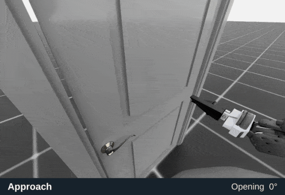

# AlexDoor-XAS

AlexDoor-XAS is a simulation benchmark for learning to push open unfamiliar doors. Does a policy generalize better when it commands the robot’s joints, moves the tool through space, or describes motion relative to the door?

A fixed-base Purdue Alex003 starts in front of a closed, unlatched door. It must approach the panel, push with the fingertips of its closed WSG32/UMI v1 gripper, hold the door open, then withdraw and stabilize.



**Qualified teacher demonstration, shown at 4× speed.** In training run D1-H+ (N01), Alex003 achieved 51.9° of controlled opening and held the door for three simulated seconds. Its fingertips cleared the panel by 2.9 cm at the end of release, and the arm stabilized. [Whole-cycle qualification results](knowledge/wiki/experiments/observed-cycle-collection.md#whole-cycle-training-conditions)

## What the benchmark compares

The study pairs four ways to command the arm with two imitation-learning methods, **Action Chunking with Transformers (ACT)** and **Diffusion Policy**. The comparison holds the demonstrations, training budget and observation history fixed across all eight pairings. [ACT](https://tonyzhaozh.github.io/aloha/) · [Diffusion Policy](https://diffusion-policy.cs.columbia.edu/)

| Action space | What the policy commands |
|---|---|
| **A1 · Joint motion** | A change in target angle for each of the seven right-arm joints. |
| **A2 · Tool motion in the world** | A change in fingertip tool position and orientation, expressed in world coordinates. Inverse kinematics maps it to joint commands. |
| **A3 · Tool motion relative to the hinge** | The same six components as A2, expressed in an estimated frame fixed at the hinge. |
| **A4 · Motion with the panel** | A sequence of approach, contact, push, hold and release segments. Each specifies a tool pose in the moving panel frame, a change in opening angle and a duration. |

Each policy receives head-mounted ZED X Mini RGB and depth images, a depth-validity mask, and arm and neck joint measurements. It must infer the door’s motion from these observations. The evaluator can read the simulated door angle and scores sustained opening against an expert reference for each door and condition, subject to contact and release requirements. [Action definitions](knowledge/wiki/topics/action-representations-and-adapters.md) · [Evaluation protocol](knowledge/wiki/implementation_phases/phase-7-training-and-generalization-evaluation.md)

## Results so far

| Experiment | Measured outcome |
|---|---|
| Door qualification | **32 doors across 12 families** have simulated expert references. Whole families stay in one split, giving 19 training doors, six development doors and seven sealed test doors. [Corpus manifest](datasets/doors/b1/corpus.json) |
| Teacher acting from observations | **17 of 36 training conditions qualified** for a complete cycle. Four doors had nine conditions each. D1 qualified in eight, D2 in all nine, and D3 and D4 in none. [Collection results](knowledge/wiki/experiments/observed-cycle-collection.md) |
| Learned control | The audited **temporal ACT-A1** campaign recorded **0 full completions in 22 attempts**. An earlier, separate A1/A2 pilot using both model families recorded **0 successes in 24 completed evaluations**. [Policy pilot results](knowledge/wiki/experiments/policy-pilot-results.md) |

The full eight-way comparison is pending. It requires validated door geometry for A3 and A4 and a matched demonstration dataset. The test doors remain sealed, and physical robot execution is unqualified. [Project status](knowledge/wiki/status.md)

## Try it from a clone

The quickest check verifies the tracked door records and their split. It needs Python 3.11+ and NumPy. Run it from the repository root.

```bash
python3 -m venv .venv
source .venv/bin/activate
python -m pip install 'numpy>=1.24'
python scripts/verify_door_corpus.py
```

The command prints JSON with `"status": "pass"`, `"doors": 32` and `"scope": "tracked_records_only"`. Simulator runs also need the local robot, camera and prepared door assets. Recordings and model weights are stored separately. [Dataset layout](datasets/README.md)

## Run a simulator diagnostic

On the RTX workstation, standard collection and door qualification use native Newton Steel physics with the Warp renderer. The D4 observed collector uses Steel with OVRTX. Pilot physics, live perception and synthetic commissioning use Isaac Sim 6.0.1 with PhysX and Isaac Lab `release/3.0.0-beta2`. The launcher chooses the runtime by script. [Runtime and asset setup](knowledge/wiki/topics/purdue-b1-robot-and-contact.md#install-the-native-b1-runtime)

With the native runtime and converted assets installed, run the two-cycle check on the 4° fixture.

```bash
scripts/isaac-run.sh scripts/qualify_door.py \
  --asset-id psx-interior-wood-002-02e442c --condition nominal \
  --diagnostic --bounded-diagnostic configs/purdue_b1_bounded_diagnostic.json \
  --output-root outputs/generated/native-evaluation-check
```

Look for `report.json` in the timestamped results directory printed by the command. A passing diagnostic exits with code 0 and reports `out_of_domain` because the fixture limits travel to 4°, below the 45° door qualification threshold. [Fixture and recording commands](knowledge/wiki/topics/purdue-b1-robot-and-contact.md#repeat-the-bounded-b1-diagnostic)

<details>
<summary>Install the project and run tests on the Isaac Sim / PhysX workstation</summary>

Use the interpreter supplied by Isaac Lab and the external Alex checkout that provides the robot and camera assets.

```bash
lab="$HOME/IsaacLab/isaaclab.sh"
"$lab" -p -m pip install -e "$HOME/Desktop/Alex"
"$lab" -p -m pip install -e '.[dev,diffusion]'
"$lab" -p scripts/check_env.py
"$lab" -p -m pytest -q tests/unit
```

The same interpreter runs `tests/gpu` and `tests/integration` on the configured workstation. CI covers linting, packaging and unit tests on Python 3.11 and 3.12. [CI workflow](.github/workflows/ci.yml)

</details>

## Work with the project

| Goal | Start here |
|---|---|
| Record a simulation episode | [Standard RGB-D collection](scripts/collect_perception.py) · [D4 observed collection](scripts/collect_d4_observed.py) |
| Inspect a recording or diagnose perception | [Perception setup and commands](knowledge/wiki/topics/perception-model-setup.md#supported-diagnostics) · [Episode format](knowledge/wiki/topics/episode-and-dataset-contracts.md) |
| Train a pilot, replay a checkpoint or run a closed-loop evaluation | [Pilot commands](knowledge/wiki/topics/b1-policy-pilot.md) · [Cluster training](knowledge/wiki/topics/cluster-training.md) |
| Navigate the code or locate a result | [Architecture and entry points](knowledge/wiki/topics/system-architecture.md) · [Output and evidence storage](outputs/README.md) · [Wiki index](knowledge/wiki/index.md) |

## License and asset credits

The project code is proprietary. A license grant requires a separate license file or written agreement. Door assets retain their individual terms. The demonstration uses Door 1 from Shakya Sidd’s *3 Doors with Animations*, adapted for closed, unlatched simulation under CC BY 4.0. [Original model](https://sketchfab.com/3d-models/3-doors-with-animations-88abf40577494c0c8759c9652e7749da) · [CC BY 4.0](https://creativecommons.org/licenses/by/4.0/) · [Asset record](datasets/doors/b1/animated-door-1-88abf40/candidate.json)
