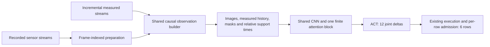

# ACT A1 observations and time

The finite-history data-to-ACT path, opt-in guarded A1 execution bridge and
native teacher collection are implemented. The initial tranche and first four-door
expansion qualify four complete nominal train motions and physically reconstructed
right/left hold/release continuations. The single existing-left initial-posture
pilot also qualifies one teacher recording, adding early approach variation while
acquisition geometry converges; see [[act-a1-four-door-expansion]]. Recovery of the
intentionally interrupted prefix remains diagnostic.
Actual prepared data pass CUDA forward/backward with unchanged weights and zero
optimizer updates. This is an explicit observation/checkpoint recipe alongside
the maintained legacy path; no ACT training or learned task success is claimed.
Historical recordings, checkpoints, physical/admission/stop requirements and the
sealed final test remain preserved.

The subsequent [[act-a1-diverse-collection|112-episode diverse campaign]] is active
within individually qualified scopes. Matched native-state diagnostics repair the
explicit-PD integration instability with240Hz physics while retaining60Hz control,
10Hz RGB-D and the same model/action configuration. Its original six attempts,
three usable episodes and three failures remain in the cumulative evidence ledger.
The linked campaign inventory owns current coverage, recovery magnitudes and all
costs. Bounded CUDA compatibility checks leave weights unchanged; the full requested
corpus remains unmet until every physical, diversity, temporal and pipeline gate passes.

The objective remains physical contact acquisition, required opening, hold,
release and normal stabilization. Offline agreement and teacher imitation do
not establish any of these outcomes. The original design is retained in Git at
`da04d38`; its saved analysis and prior negative results remain unchanged.

## Configuration

Prefer **4 s, 240×384 RGB-D, the existing shared CNN architecture, chunk 12 and
execution horizon 6** for the next integration. Retain explicit `image_size=(120,
192)` as the cheaper alternative. The revised resource measurements below support
the higher-resolution default; neither resolution has evidence of better learning.
Use full visual recomputation by default; inference reuse remains opt-in.

| Setting | Initial value | Independent meaning |
|---|---|---|
| `history_s` | 4 s | Available past support; not a required 4 s warmup |
| `image_offsets_s` | Oldest first: 4.0, 3.8, …, 0.4, 0.2, 0.1, 0 s | 22 dynamic slots, plus one static inspection reference |
| `state_hz` | 60 Hz | Robot-history sampling density; changing it does not change action timing |
| `control_dt_s` | 1/60 s | Recorded action interval; no implicit rate change |
| `chunk_size` | 12 | Predicted future A1 rows |
| `n_action_steps` | 6 | Rows to execute through existing per-row admission before replanning |

The default history has 23 images and 241 robot tokens. Each robot token contains
q9/dq9/tau7/previous applied target7, four field masks and support ages/delays.
The static endpoint remains 25 s for the existing inspection recipe, with 0.2 s
warmup and shared current-data readiness. A new reset must supply its own real
inspection/pre-roll and generation; it cannot borrow the source trajectory's past.

## Maintained interfaces



- [Shared builder](../../../src/alexdoor_xas/policies/temporal.py):
  `TemporalConfig`, `CausalObservationBuilder`, `IncrementalObservationBuilder`.
- [Preparation and sampling](../../../src/alexdoor_xas/dataset/temporal.py):
  `prepare_temporal`, `TemporalEpisode.training_rows`, `sample`, `batch`, `batches`.
- [Temporal ACT](../../../src/alexdoor_xas/policies/act/temporal.py):
  `temporal_model`, `fit_temporal_stats`, `normalize_temporal_batch`,
  `save_temporal_policy`, `TemporalActPolicy.from_checkpoint` and `predict`.
- [Native recorder](../../../src/alexdoor_xas/recording/temporal.py):
  `TemporalRecorder.state/capture/feedback/command/annotate/finish/close`.
- [Cost harness](../../../scripts/benchmark_temporal_act.py): saved-input
  preparation, loading, native preprocessing, inference and backward-only checks.

The CNN is exactly the maintained `rgbd-conv-v1` architecture: five channels,
three convolutions, GroupNorm and the 3×4 spatial grid. One finite attention block
contextualizes image and robot tokens. The **current measured-state token** is
the readout, with current q/dq also passed explicitly to its projection. There is
no recurrent hidden state, privileged crop or temporal action ensemble.

ACT accepts structured batches through recursive `collate_torch` and the existing
ACT training interface. `obs_dim=32` denotes measured feature width, not a flat
image vector. Temporal checkpoints bind preprocessing/history, joint order,
robot identity, A1 semantics and execution horizon. `TemporalConfig.model_contract()`
excludes only `static_time_s` and `warmup_s`: acquisition and readiness metadata
for each episode, not model features. Existing v2 checkpoint bytes remain valid
and unchanged; their full saved configuration is still checked internally, while
runtime/snapshot compatibility compares the model contract. Their format is
`b1.act.temporal.v2`; legacy checkpoints and flat observations cannot silently
enter this recipe. Legacy model/checkpoint behavior remains supported separately.
The simulator's legacy observer is not automatically switched to this new path.

### Opt-in A1 execution

[`temporal_a1_runner`](../../../src/alexdoor_xas/policies/act/execution.py) loads a
v2 checkpoint with the runtime robot identity, checks the control interval and
episode startup configuration, and connects an incremental builder to `B1Runner`.
The entry point fixes history/chunk/execution at **4 s / 12 / 6** and rejects
ensembling or another execution horizon. The geometry observer remains active.

```python
runner = temporal_a1_runner(
    checkpoint, observer, io, config=cfg, episode_id=episode_id,
    events=drain_native_events, feedback_contract=verified_feedback_contract,
    admission_source=existing_motion_admission, reuse=False, device="cuda: 0",
)
result = runner.run(max_ticks=declared_budget)
```

`drain_native_events(sensor, observation)` supplies newly available event
arguments for `IncrementalObservationBuilder.append`: field, actual acquisition
and availability clocks, generation, measured/preprocessed values, image source
index and validity. Images use the shared `preprocess_rgbd`. Applied-target
history requires actual delivered/acknowledged targets; the bridge never turns a
prediction or request into an application. Producers own their reset and clock
conversion. The native teacher adapter now feeds the same measured events to recording and
incremental observation ingress; measured simulation coverage is described below.

Per-action readiness now selects only static/current image support and current
q/dq through the same causal selection/validity function as the model-input
builder. It performs no image reads. Replanning alone materializes the full
history, reading selected events rather than stacking the ingress visual corpus.
A bounded 60-action numerical runner replay at 240×384 preserved all ordered
commands, 10 queries and stop behavior. The 50 pending-action ticks fell from
14.27/16.72 ms p50/p95 to 2.86/2.99 ms; query ticks from 14.88/16.61 to
10.40/11.22 ms. These costs include observer-to-dispatch with numerical admission
and IO, not CUDA inference or physics. Evidence:
[runner replay](../../../outputs/evidence/act-a1-teacher-temporal-20261019/runner-replay-cost.json).

The bridge checks current sensory readiness and freshness **before every row**,
including rows pending from the previous prediction. It executes rows 0–5 in
order, discards rows 6–11, and replans from the next measured history. Reset and
stop clear pending actions, ingress and visual reuse. Ingress reset follows the
geometry provider's generation, matching the actual `B1Observer` output even when
the provider was initialized/reset independently; observers without a provider
use their own generation. A generation change during execution still requires a
reset and fresh history. Each delta still passes
through existing per-row admission, `ActionAdapter`, `PurdueIO` and the measured-q
joint controller; no physical threshold or stop rule changes.

Saved numerical events and an actual CUDA checkpoint verify ordered dispatch,
replanning, current-q conversion, stale input stopping inside a chunk, reset,
admission refusal, physical-stop propagation, and robot/joint/control mismatch
rejection. These checks do not validate physical task completion, a hardware
producer, real sensor-to-actuator latency or contact qualification.

### Startup compatibility and mixed consumption

One initialized model/checkpoint can consume the normal 25 s reference and the
fresh intermediate t=0 reference. Both use the same static role marker, real
relative support clocks and masks. No timestamps/history are rewritten. All
other configuration fields, including freshness rules, remain strict. Readers
reject startup metadata differing from the recorded episode when it is present.

For nominal execution the shared closed-door inspection remains required. A
loaded intermediate uses `temporal_a1_runner(..., config=episode_config,
startup=qualified_startup)`, where `static_time_s=0`. The explicit callable
`qualified_startup(observer, io)` runs after IO reset and returns `(observation,
reason)`. The producer owns physical reconstruction, contact qualification,
fresh local reference and guarded pre-roll; a nonempty reason takes the usual
stop path. Without this producer an intermediate configuration is rejected.
The runner never parks/scans a loaded intermediate through nominal inspection.
This is a maintained numerical execution interface, not a newly validated
physical learned continuation. Every dispatched row still requires current
readiness, geometry/admission and the original controller/stop limits.

`mixed_temporal_batch([(episode, rows), ...], horizon=12)` checks common model
semantics and preserves selection order, masks and action padding. Its top-level
`episode_id`, `decision_row`, `decision_time_s` and `generation` remain audit
metadata outside `obs`. Distinct files with the same episode identity are
rejected. Fit one `fit_temporal_stats` on the unique explicitly admitted train
episodes, then apply that same normalization to every component of the batch.

### Preparation and consumption

Read `depth_interval_m` from the recording's calibration; do not replace its
validity interval with the 5 m normalization/saturation scale. For a legacy
simulation file, the explicit `legacy_synchronous=True` declaration acknowledges
that hardware arrival clocks were never recorded.

```python
cfg = TemporalConfig(depth_interval_m=recorded_depth_interval)
prepare_temporal(source, prepared, cfg, eligible=reviewed_command_mask,
                 legacy_synchronous=True, device="cuda: 0")
with TemporalEpisode(prepared, cfg) as episode:
    rows = episode.training_rows(horizon=12)  # numeric support; no image reads
    stats = fit_temporal_stats([episode])    # unique training episodes only
    batches = (normalize_temporal_batch(batch, stats)
               for batch in episode.batches(rows, batch_size=32, horizon=12))
    # batches feed the existing ACT tensor interface; no training is run here.
```

`reviewed_command_mask` is required to admit supervision. Its default is all
false, including for failed/interrupted/ambiguous recordings. Chunks intersecting
an ineligible real command or an internal target hole are excluded. True tail
padding marks absent targets, never fabricated zero-action stabilization. A
terminal observation can be ready sensory context while having no expert target.
Inspection and other rejected actions may remain real historical context.

Training normalization fits action statistics and supported healthy tau only on
explicitly admitted training rows. q/dq and previous targets retain physical
units. Missing values are zero after normalization with separate false masks;
constant tau channels keep unit scale rather than amplifying numerical noise.
No generic ±10 clipping is applied to measured N m. Dataset grouping remains by
frozen door/trajectory family; rerenders, crops, recoveries and reset derivatives
must stay in their source group's split. No final-test reader is authorized.

### Full coverage and reviewed usable supervision

`review_native_collection` reports task outcome/physical-safe command counts,
recording integrity/completeness/terminal support, required phase/transition
coverage, and explicit candidate command/window ranges separately.
`data_usable` means that trusted ready windows exist; it does **not** qualify a
full demonstration. `required_scope_coverage` requires usable starts in every
required phase and crossings for every required transition.
`full_demonstration_coverage` additionally requires a nominal full-task scope. Nominal cycles require
inspect→approach→contact→push→hold→release→stabilize; the existing qualified
intermediate requires hold→release→stabilize. `pilot_physics collect` retains this
scope-coverage requirement for `demonstration_qualified`, plus task and stop gates;
`full_task_success` remains separate from a qualified continuation.

Successful complete source outcomes remain prerequisites for automatic teacher
candidates. Accepted, safe, phase-valid actions and qualified contact semantics
then determine row masks. Failed/interrupted sources never automatically acquire
expert labels. Unhealthy/missing tau remains optional masked observation support:
raw substep counts, source contract and actual missing selected historical/current
slots are reported separately. A short unselected substep gap may affect no token;
a selected gap affects overlapping histories according to the existing two-tick
support rule. Neither case invents torque or erases otherwise trusted targets.
Prepared files retain `source_feedback_contract` as provenance.

The first right attempt remains a physically complete pass with its original
outcome, no inspect→approach crossing and no full-demonstration qualification.
The new read-only review identifies 7,337 candidate starts, inclusive zero-based
rows 1512–8848 (25.2 s onward), covering the later approach/contact/push/hold/
release/stabilization. Reuse would require a separate explicit **partial-source**
admission and its reviewed command mask, not the full-demonstration gate. Its
original episode identity collides with corrected right: if later admitted,
`prepare_temporal(..., episode_id="...-attempt-1-reviewed-partial")` writes a new
derivative with `source_episode_id`; raw data stay unchanged and source/family
split stays train. No such derivative/admission is created here. New native
attempts receive unique episode IDs while retaining their family/source links.
Mixed batching and normalization reject duplicate identities across distinct files.

### Phase-focused source views and short subtasks

`phase_focused_rows(episode)` returns valid prepared decision-row views around
first qualified contact acquisition, contact→push, hold→release and release→
stabilization. Relative offsets are `(-H+1, -N, -1, 0, 1, N)` for chunk H=12 /
execution N=6; stabilization also includes the last genuine command. Pass each
row union directly to the existing `episode.batches` or `mixed_temporal_batch`.
No image file is copied, history truncated/rebased, boundary-crossing window
removed or phase annotation passed into `obs`. Existing `training_rows`, causal
masks and real-tail padding decide admissibility. Missing event coverage is an
empty row view, not an invented demonstration.

The reviewed seven-source baseline has 41,757 reviewed commands (34,647 push, 82.97%) and
41,716 usable window starts after the single existing-left posture pilot. The
seven records contain five complete reset motions on four doors across three
train families plus two hold derivatives. Event-focused views retain 25 per
complete source and 13 per hold continuation: 151 overlapping source-row views,
not 151 demonstrations. The new source contributes 7,729 starts and 25 focused
views; its bounded consumption reuses the unchanged initialized checkpoint and
normalization fitted only to the previous six admitted train sources. No
optimizer update or new fit is performed. See
[posture audit](../../../outputs/evidence/act-a1-posture-20261019/verification.json)
and [[act-a1-four-door-expansion|physical/observed coverage and limits]]. Actual prepared
references and per-phase denominators are in the prior six-source
[four-door audit](../../../outputs/evidence/act-a1-four-door-20261019/verification.json);
the [original consumption audit](../../../outputs/evidence/act-a1-consumption-20261019/sampling-quality.json)
remains the three-source baseline.
A later sampler can visit the unique event views explicitly alongside background
windows using existing batching; no equal-phase quota or training schedule is
selected here. Keep per-source/door/transition exposure visible so push length
does not determine all minibatches. Statistical evaluation remains by independent
source/group, not overlapping rows.

A future short episode declares `metadata.subtask = {name, required_phases}` as
an ordered phase sequence. Outcome reports `subtask_success` separately from
`subtask_qualified`; both must be explicitly true, with successful execution,
complete recording and safe/phase-valid command labels before teacher candidate
masks can be nonzero. Release/stabilization are required only if in that declared
subtask sequence. Full-task outcome and nominal full-coverage gates are unchanged.
Unqualified short episodes remain readable diagnostics with zero automatically
admitted windows, even when a proposed observable condition says success.
No contact-acquisition or contact→push reset/physical success criterion is
qualified by these interface/tests. The existing C hold/release continuation
retains its measured qualification and separate continuation scope.

## Causal, reset and storage contract

For historical slot s at decision t, select the latest same-generation acquisition
with `acquired <= s`, `available <= t` and verified episode clock conversion.
A previous applied target additionally requires **dispatch < s** and application/
availability no later than s. The command at t and all requested/future targets
are excluded. A1 labels remain applied target minus measured q immediately before
that command. Each executed delta must still be added to the q measured for its
own execution row by the existing action adapter.

The static image's learned age is the constant `-1` role marker; its arrival
minus acquisition delay remains relative support. Recent images retain their
relative ages and delays. Absolute static acquisition/arrival timestamps remain
outside learned inputs for alignment and diagnostics. The revised temporal v2
checkpoint format prevents silently reinterpreting experimental v1 weights;
legacy flat ACT/Diffusion checkpoint formats are unchanged.

Current q/dq and a recent image are required. Historical gaps are masked, not
turned into automatic refusal. The initial image gap allowance is 0.15 s; state/
feedback support uses two control ticks. These are operational freshness choices,
not physical precision or hardware qualification. RGB with unavailable depth can
remain an image with zero depth coverage. Invalid historical image tokens are
masked. Clock regression on ingress invalidates it until reset; unconverted clock
domains are rejected. Reset clears static/history/targets and inference features.

Torque must have declared origin, semantics, named arm7 order, N m units, positive
joint-coordinate sign and health. Legacy simulated `joint_output` is solver DOF
feedback, not external contact force. Unverified hardware tau remains masked.
Effort feedforward, calculated actuator torque, modeled load, contact truth,
phase, progress, door identity and evaluator annotations never enter ACT inputs.
The measured arm7 order is `ARM_JOINTS`; observed9 adds `NECK_Z`, `NECK_Y`.
Hardware source/scale/sign, saturation/filtering, latency, clocks and installed
F-T/tactile availability remain unverified.

Prepared `b1.temporal-frames.v1` stores images once with source indices, separate
numeric streams and action rows. History/density/prediction changes are reader
views of the same file. Production preparation retains all native capture rows;
legacy 60 Hz expert images are viewed at 10 Hz without rewriting raw recordings.
The benchmark's explicit frame subset is a cost fixture, not a complete new
recording. Loading has a bounded 64-frame cache, at most 8 MiB of retained numeric values
and existing one-batch prefetch;
no visual corpus or expanded sliding-window dataset is materialized. Incremental
ingress has declared rate/capacity bounds, static retention and target carry-in;
overflow fails visibly. Raw source paths and all historical evidence remain.

## Reviewed baseline measurements (historical)

Evidence: [complete local measurements and attempts](../../../outputs/evidence/act-a1-temporal-implementation-20261019/summary.json),
[matched native detail](../../../outputs/evidence/act-a1-temporal-implementation-20261019/matched-native-detail.png).
One saved **training** episode, 183 identical selected frame indices, nine startup/
nominal/transition/terminal snapshots, four-second history and identical seeded
CNN weights at every resolution. No trained policy was selected. Model weights
were initialized for cost/gradient checks; these are not learning comparisons.

Declared budget: one RTX 4090, 18 GiB VRAM, 8 GiB process RSS, 15 minutes of GPU
measurements. All runs stayed within it. Each resolution has a measured batch-1
memory probe before batch 32, three forward/backward passes with no optimizer,
and 12 contiguous inference queries per full/reuse path. Prior failed harness
attempts and intermediate graph/cache measurements remain, including the wrong
initial depth interval, missing import/contract wiring and the ineffective first
cache implementation. Only affected measurements were repeated after code fixes.

| Resolution | Prepare 183 frames | Batch-32 load / transfer | Batch-32 fwd+bwd median (min–max), ms | Peak allocated / reserved VRAM, GiB | Peak process RSS, GiB |
|---|---:|---:|---:|---:|---:|
| 60×96 | 1.92 s | 118 / 5 ms | 9.9 (9.7–40.3) | 0.56 / 0.94 | 1.66 |
| 120×192 | 1.93 s | 269 / 19 ms | 24.1 (23.7–44.9) | 1.88 / 2.52 | 2.15 |
| 240×384 | 2.01 s | 865 / 73 ms | 94.8 (92.2–96.5) | 7.42 / 9.60 | 4.22 |

Preparation includes disk read/decode, GPU transfer/pooling, return transfer and
frame-store writing. Loader costs include joins and bounded frame maintenance;
model measurements use float32, the intended batch 32, and the final current-state
readout. Action/torque statistic fitting is checked separately, not fitted to the
real benchmark's unreviewed labels. First convolution/backward calls remain in
the reported variability; three samples are insufficient for robust tail estimates.

| Resolution | Complete batch-1 full path p50 / p95, ms | Reuse p50 / p95, ms | First model forward | Native history fill |
|---|---:|---:|---:|---:|
| 60×96 | 11.70 / 13.79 | 13.06 / 14.96 | 134 ms | 247 ms |
| 120×192 | 16.75 / 17.42 | 16.21 / 18.89 | 133 ms | 244 ms |
| 240×384 | 31.16 / 32.76 | 29.85 / 34.31 | 141 ms | 248 ms |

The complete saved-input path includes native image read/decode, CUDA pooling and
return transfer, history join/load, required transfer to ACT, visual computation/
feature-cache maintenance, temporal context and action return transfer. New-frame
preprocessing is about 8.5–9 ms on this fixture; model construction is about 12 ms.
History fill and first forward are separate startup costs. This is saved-stream
wall time, not measured sensor-to-actuator hardware latency or physics throughput.

### Historical inference reuse decision (12 queries)

The bounded cache stores only deterministic visual features (64 entries), never
training latents. `reuse=True` keeps host snapshots and transfers/encodes misses
only; temporal context is always recomputed. It invalidates on reset, encoder
weight version/storage changes, device/dtype or preprocessing changes. Training
and grad-enabled calls recompute with correct gradients.

Full/reuse outputs agree within maximum absolute **6.2e-7** in model output on the
final measured graph. The first two queries fill the interleaved visual history;
all 12 samples are reported above. Across the following ten queries, 240×384
median falls from 31.16 to 29.50 ms, while p95 changes from 32.00 to 32.34 ms.
At 120×192 median gains are small and tail latency regresses; 60×96 is slower with
reuse. Keep reuse **off by default**. It is a measured median-cost option for the
240×384 fixture, not a proven deadline improvement.

### Resolution decision and limits

60×96 visibly merges finger/panel edges. 120×192 retains more contour detail and
is feasible at batch 32 with substantial VRAM margin; 240×384 retains more fine
geometry but costs about four times the backward time and allocated VRAM.
These observations justified the original 120×192 compromise, not learning
superiority; the representative delivery measurements below supersede that default. Even native hold/release images show arm self-occlusion; resolution
cannot recover hidden contact. No resolution is certified for millimetric contact.

The proposed 16.7 ms deadline applies only if future hardware uses a synchronous
60 Hz dispatch schedule. It is not a universal gate for this offline pipeline.
The 120×192 saved path already has p95 above that budget before live admission/
IO costs; startup also exceeds it. Hardware real-time readiness is **unvalidated**.
No control rate, asynchronous execution or dispatch compensation was introduced.

## Representative input delivery

New evidence is preserved separately in
[`act-a1-temporal-integration-20261019`](../../../outputs/evidence/act-a1-temporal-integration-20261019/).
The reviewed measurements above repeat five distinct decisions. The new matched
before/after profiles use three fixed batch-32 workloads: 32 distinct decisions
spread across the saved training trajectory; 32 consecutive, overlapping
decisions; and eight spread decisions plus 20 consecutive decisions and explicit
duplicates. Every workload retains all 23 RGB-D images, 241 robot tokens and 12
targets. Diagnostic labels remain ineligible for training.

Profiles precede optimization and are kept with five raw timing repetitions per
pattern/resolution. They identify repeated visual gathers/stacks/copies as the
main cost, followed by small numeric HDF5 reads. The target fixed before changing
the loader was a 50% reduction in matched median construction time, with the same
64-frame cache, one delivered plus one prefetched batch, 8 GiB RSS and 18 GiB
allocated VRAM budget. OS page cache was not flushed; application frame-cache
cold costs must not be called cold-disk measurements.

The builder now exposes numeric support without materializing images. Each batch
joins each distinct decision once and writes distinct frames directly into final
batch storage, restoring every duplicate and original sample order. The 64-frame
LRU never grows with a batch. At most 8 MiB of numeric values are retained per
open episode; larger numeric datasets remain lazy. Targets, internal holes,
eligibility, true tail padding, masks, preprocessing and normalization retain
single-sample semantics. The existing one-next-batch prefetch helper is reused;
there is no expanded window dataset or GPU feature cache during backward work.

| Resolution | Distinct windows, before → after | Overlapping windows, before → after | Mixed with duplicates, before → after |
|---|---:|---:|---:|
| 120×192 | 207 → 104 ms | 158 → 65 ms | 173 → 76 ms |
| 240×384 | 860 → 308 ms | 721 → 185 ms | 770 → 223 ms |

The original 50% target is met in **5/6** cases. Distinct 120×192 reaches 49.8%
and remains just below it; the target was not relaxed. The first copy-only
optimization and its weaker 120×192 results remain in the evidence. Numeric
retention addresses the measured residual reads; joins themselves were not
replaced by a second causal implementation. Cold frame reads for the mixed batch
fall from 243 to 237; direct final-buffer materialization supplies most of the
benefit. Distinct batches still read 646 frames, overlapping batches 47. A cold
646-read batch evicts 582 entries from the fixed 64-frame LRU.

[`benchmark_temporal_pipeline.py`](../../../scripts/benchmark_temporal_pipeline.py)
measures **eight complete batches per workload**, with one bounded CPU prefetch
thread, normalization, collation, H2D, synchronized float32 forward/backward and
cleanup. Untimed per-sample comparisons establish exact order, duplicates,
actions, masks and normalization before timing. The source labels stay diagnostic;
seeded initial model weights and backward passes are not policy training.

| Resolution | Complete wall / 8 batches: distinct / overlap / mixed, ms per batch | Median H2D | Median GPU forward/backward | Peak allocated / reserved VRAM | Peak RSS |
|---|---:|---:|---:|---:|---:|
| 120×192 | 129 / 77 / 91 | 20 ms | 24–25 ms | 1.88 / 2.51 GiB | 2.18 GiB |
| 240×384 | 355 / 223 / 274 | 85–88 ms | 94 ms | 7.39 / 9.34 GiB | 4.24 GiB |

These wall averages include first delivery and pending-reader cleanup; they are
not sums of overlapped stage medians. Loading remains the throughput bottleneck.
One-time first model backward calls and every per-batch duration remain in the
JSON. The approximately fourfold image/compute cost of 240×384 remains explicit;
its measured memory and delivery cost are practical within the declared bounded
workstation budget, supporting the information-preserving default. 120×192
remains supported as the cheaper alternative. Neither has learning evidence.

AdamW's two FP32 moments were actually allocated without `optimizer.step` and
remained resident during the batch measurements: **12.50 MiB**, with 6.25 MiB of
parameters and corresponding gradients. A prospective foreach temporary of about
one parameter-sized buffer is an **estimate**; optimizer-step latency and its
transient peak were not measured. No optimizer update occurred.

### Incremental reuse: fill, steady operation and numerical result

The actual `IncrementalObservationBuilder` → `TemporalActPolicy.predict` path
replays the same native saved events at 151 decisions, six control ticks apart.
Each query includes new native RGB-D reads/decode, CUDA preprocessing/return,
numeric event ingress, causal construction, normalization, required transfers,
ACT and action return. Three trials per mode alternate order. The first history
and prediction cost is separate (120×192: 366–378 ms; 240×384: 405–415 ms). The
next **40 queries / one whole 4 s history cycle** are retained as cache fill;
**110 steady queries per trial, 330 per mode** remain. Serial queries are correlated;
empirical p95 values do not establish a deadline guarantee.

| Resolution | Full recomputation steady p50 / p95 | Reuse steady p50 / p95 | Untimed strict numerical comparison |
|---|---:|---:|---|
| 120×192 | 16.38 / 16.97 ms | 16.40 / 16.88 ms | Fails in 86/150 queries, 109/12,600 components |
| 240×384 | 41.10 / 41.88 ms | 39.31 / 40.47 ms | Passes in 150/150 queries, 12,600 components |

The table reports the median of the three trial p50/p95 statistics; complete
trial ranges and all fill/steady samples remain in
[`summary.json`](../../../outputs/evidence/act-a1-temporal-integration-20261019/summary.json).
Equivalence comparisons are separate, untimed passes with the existing
`atol=1e-6, rtol=1e-5` criterion. Maximum absolute output differences are 2.27e-6
at 120×192 and 1.40e-6 at 240×384 with identity diagnostic action scaling. The
first strict 120×192 assertion failure and the complete census are both kept;
no tolerance was changed to pass it. Small absolute differences alone do not
establish equivalence under the declared criterion or a physical safety result.

**Keep reuse off by default at both resolutions.** At 120×192 it provides no
meaningful latency gain and fails the strict numerical criterion. At 240×384 it
passes this saved-trace check and reduces median/tail time by about 4%; it remains
an explicit measured option, not a qualified default for a future learned
checkpoint or hardware producer. Use the preferred 240×384 path with full
recomputation for collection consumption and later ACT work. No asynchronous execution,
control-rate change or physical threshold adjustment was introduced.

## Native teacher collection and phase quality

[`pilot_physics.py collect`](../../../scripts/pilot_physics.py) connects the
maintained scripted expert through
[`TemporalExpertRecorder`](../../../src/alexdoor_xas/recording/teacher.py).
Actual controller, native feedback and measured state/capture events feed both
`TemporalRecorder` and incremental causal ingress. Original 600×960 RGB-D,
validity, calibration, timestamps and native frame IDs remain lossless at 10 Hz;
control/full robot state is 60 Hz. Legacy native arm7 feedback is 120 Hz; the
opt-in diverse-collection runtime records every 240 Hz physics substep while keeping
control and RGB-D rates unchanged (see [[act-a1-diverse-collection]]).
No raw frames or ordinary-control rows are fabricated.

Nominal collection uses the unchanged 25 s inspection reference followed by an
explicit .4 s parked-joint pre-roll: .2 s current-input readiness plus one 12/60 s
horizon for inspect→approach windows. Approach/contact/push/hold/release control
is retained. Real withdrawal is followed by ordinary Cartesian control for at
least 2 s, extending to at most 6 s. The final .5 s requires unloaded separation
>=10 mm, arm speed <=.016667 rad/s (one reference step across the window), door
speed <=1 deg/s (the existing .5 deg tie across the window) and tool excursion
<=the existing 2.5 mm drift guard. These empirical settling bounds are separate
from hard safety limits and do not require numerical stillness or an open door.
The caller finalizes once after this tail. Separate continuing-physics safety
verification starts after recorder detachment and cannot supply expert tail rows.
The legacy nominal `stop_reason=safety_stop` names the push-exit guard; it is not
a latched stop replacing normal release/stabilization.

Physical safety, task-phase validity, recording completeness and safety-stop
outcome remain separate. `teacher_eligibility` requires a passed complete cycle.
Unloaded contact acquisition can qualify before initial contact; once acquired,
weak/ambiguous contact rows remain diagnostic until validity returns. Push/hold
require contact/load/footprint/material validity. Qualified withdrawal and normal
tail rows remain eligible after contact ends. Whole chunks crossing ineligible
real commands are excluded, preserving phase-crossing windows and genuine tail
padding. Original **68 weak-load samples in 26 historical intervals** remain
untouched and diagnostic; corrected right adds 14 separate diagnostic rows.
Teacher phases, truth, evaluator output, load estimates and absolute progress
remain outside ACT observations.

### Requests, delivery, clocks and units

The actual request kind/value/time and joint request produced before any limiter
are retained separately from delivered targets, q_before, clipping, neck/gripper
setpoints and feedforward effort. A1 labels remain delivered target minus its own
measured pre-state. Refusals have no dispatch/application acknowledgement or
applied target and cannot overwrite previous delivered-target history.
Simulation acquisition/availability use one explicit local episode clock;
delivery is controller-setter success, not reached position or an invented
hardware acknowledgement. SIGUSR1 identifies a declared resource-budget
termination; SIGTERM identifies interruption. Errors before recorder startup
report `recording_not_started` and preserve reset-physics diagnostics.

Measured arm7 tau comes from `get_dof_projected_joint_forces`, explicitly
`simulated_actuator_feedback` / `joint_output`, in N m and positive URDF joint
motion coordinates, with resolved `ARM_JOINTS` order and per-sample health.
Offline and incremental ingestion share the origin/order/units/sign predicate.
This is projected solver feedback, not direct contact force or hardware tau
qualification. Full robot diagnostics declare units per joint: rotational effort
is N m and prismatic WSG jaw effort is N. The legacy full `effort_target_nm`
container has explicit `joint_names`, per-joint `units` and feedforward semantics;
its values never supply measured tau. Unit annotation adds metadata only.

`validate_native_recording` reviews N+1 states/N outcomes, clocks, q_before,
requested/delivered semantics, native frame uniqueness and all torque substeps.
`review_native_collection` and prepared `TemporalEpisode.training_rows` share
`training_decisions` and builder readiness, with no image materialization.
Prepared-store completion describes index writing: `source_complete`,
`source_outcome` and `source_terminal_support` retain the source episode status.
Interrupted sources are prepared/reopened diagnostically with unchanged real
counts, no added terminal state and no eligible expert windows.

### Qualified physical hold-state resets

`--intermediate-state <qualified-source>/teacher/hold-state.npz` restores full
robot q/dq, door position/velocity, controller targets/impedance, hold lead and
compression/compensation. Six actual reset-conditioning ticks rebuild contact
and feedback, retained in a separate audit. A new local generation/time origin
then begins with refreshed collision/camera state, its own t=0 inspection image
and fresh 1 s physical pre-roll. Global physics continues. No source image/state
prefix is attached. A sustained .5 s loaded/material-valid hold must qualify
before release; exact solver-cache or bitwise state reproduction is not assumed.
The per-record static endpoint is 0 s for this reset; learned fields and 4 s /
240×384 / 12 / 6 recipe remain the same, with unavailable history masked.

The original right reset changes source generation 1 to generation 2. Reconstruction
errors are 0.566 mrad q, 38.655 mrad/s dq, 0.643 mrad door angle, .259 mm tool
position and .482 mrad tool rotation, within declared state bounds and existing
hard safety limits. Fresh pre-roll has 58/60 valid contact samples. Its first
snapshot has only 2/241 q/dq/tau slots, one previous target and 2/23 images;
first eligible decisions occur at .2 s, without waiting four seconds.

## Initial bounded physical/data tranche and handoff

[Declaration](../../../outputs/evidence/act-a1-teacher-temporal-20261019/declaration.md),
[all attempts and commands](../../../outputs/evidence/act-a1-teacher-temporal-20261019/report.md),
[actual-data verification](../../../outputs/evidence/act-a1-teacher-temporal-20261019/verification-final/report.json)
and [ready inputs](../../../outputs/evidence/act-a1-teacher-temporal-20261019/handoff.json).
The fixed train identities are right `animated-door-1-88abf40` and left
`door-2738468b94d74c5f`, nominal seed 6200. Required opening retains 80% of the
frozen matched references (51.260252/52.536029 deg), never a refit on these results.

| Retained attempt | Physical outcome | States/commands | Healthy native tau | Data outcome |
|---|---|---:|---:|---|
| First right | 51.11 deg, release + 2 s ordinary tail; stop passes | 8,850/8,849 | 17,699 | Incomplete inspect→approach coverage; 7,337 partial candidates, separate admission required |
| Corrected right | 51.75 deg, release + 2 s ordinary tail; stop passes | 9,101/9,100 | 18,201 | Qualified; 7,537 training windows |
| Left | 52.55 deg, release + 2 s ordinary tail; stop passes | 9,509/9,508 | 19,017 | Qualified; 7,996 training windows |
| Physical reset C | Fresh loaded hold, release + 2 s ordinary tail; stop passes | 541/540 | 1,081 | Qualified continuation; 528 training windows |
| Controlled interruption D | Delivered command 60, interrupted before post-state; stop passes | 60/60 | 119 | One missing terminal state; recovered, zero expert windows |

The first right exposed a real readiness seam: approach began at 25 s while
inputs first became ready at 25.2 s. One affected repeat followed the explicit
.4 s ordinary pre-roll correction. The original outcome/report remain; its early
demonstration flag predates the completed window gate and does not qualify it
for handoff. No unchanged favorable retry occurred. All present transitions in
the three admitted files retain 11 crossing windows. These overlapping windows
and one reset derivative are not independent demonstrations or a success-rate
estimate. Source/family train grouping remains frozen; C stays with its source.

All 56,117 native torque vectors across five attempts are finite/healthy under
the simulator API contract; none is missing, and none of the seven channels
reaches >=99% of configured effort limits. No saturation flag is exposed: this
comparison is diagnostic, not sensor saturation certification.
[Native event-centered traces](../../../outputs/evidence/act-a1-teacher-temporal-20261019/torque-event-traces.json)
and figures retain all seven channels around contact, hold and real release.
Actual prepared batches pass finite CUDA forward/backward with image, temporal,
measured-state and torque gradients, exact unchanged weights and zero optimizer
updates. Live/offline representative snapshots include true terminal/tail states;
A1 labels and causal previous-target support agree exactly. Valid N m changes
reach ACT tensors; invalid/missing tau is masked. D reopens through ACT preparation
with the real prefix and zero eligible windows. Focused numerical tests pass.

Five whole launches consume 1,229.03 s (20.48 min); final CUDA verification takes
17.75 s, plus a 5.51 s exact CUDA-tensor reach check. Peak simulation process-tree RSS is 7.73 GiB and total GPU memory is
6.87 GiB including desktop graphics. Final validation uses 1.96 GiB process RSS
and peaks at 1.65/3.67 GiB CUDA allocated/reserved. About 28.8 GiB of tranche data
is retained, within the declared 80 GiB; all per-case/cumulative budgets hold.
No remote allocation, optimizer update, final-test access or learned evaluation
is added. This closes the collection tranche, not ACT physical task success.

The concrete [[act-a1-four-door-expansion|four-door expansion proposal]] uses
actual train geometry, measured margins/costs and targeted-start qualification
boundaries. Next expansion starts from the three admitted records in `handoff.json`, with
explicit masks and per-record observation configurations. Add data only through
a declared train protocol and the same release/tail, native-feedback, transition
and interruption gates; retain every attempt and source-group derivative.
Statistics fit only on admitted training data. Later learned success must be
physical opening/hold/release/normal stabilization from the policy's observations;
teacher trajectory similarity is not the primary criterion.

### Source decisions and remaining limits

[StageACT](https://arxiv.org/html/2509.13200v2) supports proprioceptive/torque review
of contact transitions and identifies observational phase ambiguity; its
privileged stage input/architecture is not adopted.
[DoorBot](https://arxiv.org/html/2504.09358v1) supports closed-loop haptic
verification and explicit failures; its sensors/planner are not imported.
[MimicGen](https://mimicgen.github.io/docs/tutorials/datagen_custom.html) supports
task-specific subtask end conditions and diagnostic annotations; its framework
and randomized offsets are not adopted. These sources do not qualify this reset
or Alex hardware feedback. The
[existing hardware audit](../../../outputs/evidence/act-a1-observation-design-20261019/analysis.md)
continues to leave source/scale/sign/noise/filtering, clocks/latency and installed
F-T/tactile availability unverified. Historical
[[../experiments/b1-data-pipeline|data infrastructure]],
[[../experiments/b1-act-a1-two-door-diagnostic|learned failures]] and
[[../experiments/b1-act-a1-calibration-stopping|calibration/stopping]] remain unchanged.

## First four-door expansion

The [[act-a1-four-door-expansion|bounded four-door expansion]] now adds physically
qualified complete nominal recordings for right `psx-front-005-ee7d5c6` and left
`psx-interior-wood-002-02e442c`, plus a qualified hold/release continuation from the
existing left source. Current-setup applicability of fixed opening requirements
is verified separately before scored collection; no maximum reference or physical
gate is refitted. Original records and this page's initial-tranche outcomes remain.

The six-record train union reuses the same observation/checkpoint contract,
shared train-only normalization, complete eligible windows and phase-focused
views. It passes actual CUDA consumption without updates. Fresh left reconstruction
has its own generation/reference and genuine pre-roll, with unavailable earlier
history masked. Full nominal task success and continuation success remain separate.
The linked expansion page owns current counts, costs, evidence and the proposed
initial-posture tranche. No learned task success or policy training is added.

Native teacher recordings additionally retain diagnostic arm q/dq, delivered
position/velocity targets, computed PD plus feedforward effort, clipped commanded effort and gravity
feedforward at every existing physics-feedback acquisition. These fields preserve
oscillations and saturation for failure diagnosis; they are excluded from the
observation allowlist. Projected solver joint output remains the distinct measured
simulated torque input, with hardware verification false. Computed/applied effort
refers to the preceding native interval, not a force measurement. No native rate,
control/visual rate, model feature, label or older recording changes.

A full recording includes the actual head-inspection prefix, while teacher/trace.json
uses a probe-relative clock beginning after inspection. Native motion/target audits
cover every recording row; trace-specific speed peaks join after the explicitly
recorded inspect prefix and verify the remaining evaluator phases exactly. The
inspection prefix is retained and reported separately, never truncated to hide
motion. Short phase recordings have no inspection prefix.
