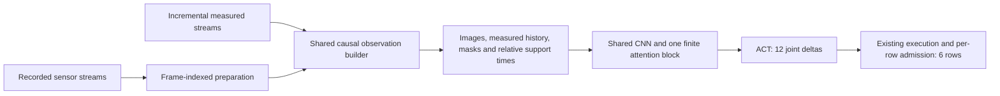

# ACT A1 Observations and Time

This page owns causal temporal observations, checkpoint compatibility, execution
and collection interfaces. The current pause/results belong to [[status]];
[[../experiments/act-a1-first-completion|the learning experiment]] and
[[../experiments/act-a1-complete-cycle-collection|complete-cycle collection]] own
scientific outcomes. Numerical or teacher checks do not establish learned task
completion or hardware qualification. Historical pipeline/resolution measurements
are canonical in [[../experiments/b1-data-pipeline]].

## Configuration

The maintained integration uses **4 s, 240×384 RGB-D, the existing shared CNN
architecture, chunk 12 and execution horizon 6**. Retain explicit `image_size=(120,
192)` as the cheaper alternative. The [[../experiments/b1-data-pipeline|historical resource measurements]] support
the higher-resolution default; neither resolution has evidence of better learning.
Use full visual recomputation by default; inference reuse remains opt-in.

| Setting | Initial value | Independent meaning |
|---|---|---|
| `history_s` | 4 s | Available past support; not a required 4 s warmup |
| `image_offsets_s` | Oldest first: 4.0, 3.8, …, 0.4, 0.2, 0.1, 0 s | 22 dynamic slots, plus one static inspection reference |
| `state_hz` | 60 Hz | Robot-history sampling density; changing it does not change action timing |
| `control_dt_s` | 1/60 s | Recorded action interval; no implicit rate change |
| `chunk_size` | 12 | Predicted future A1 rows |
| `n_action_steps` | 6 | Rows to execute through existing per-row admission before replanning |

The default history has 23 images and 241 robot tokens. Each robot token contains
q9/dq9/tau7/previous applied target7, four field masks and support ages/delays.
The static endpoint remains 25 s for the existing inspection recipe, with 0.2 s
warmup and shared current-data readiness. A new reset must supply its own real
inspection/pre-roll and generation; it cannot borrow the source trajectory's past.

## Maintained interfaces



- [Shared builder](../../../src/alexdoor_xas/policies/temporal.py):
  `TemporalConfig`, `CausalObservationBuilder`, `IncrementalObservationBuilder`.
- [Preparation and sampling](../../../src/alexdoor_xas/dataset/temporal.py):
  `prepare_temporal`, `TemporalEpisode.training_rows`, `sample`, `batch`, `batches`.
- [Temporal ACT](../../../src/alexdoor_xas/policies/act/temporal.py):
  `temporal_model`, `fit_temporal_stats`, `normalize_temporal_batch`,
  `save_temporal_policy`, `TemporalActPolicy.from_checkpoint` and `predict`.
- [Training](../../../scripts/train_temporal_act.py) and
  [sampling](../../../src/alexdoor_xas/policies/act/temporal_training.py): index the
  admitted handoff, balance doors then phase/transition/recovery strata, fit only
  selected training data and save self-contained checkpoints plus optimizer/RNG
  state. `--resume` preserves step counts and requires the same seed/statistics.
- [Native event ingress](../../../src/alexdoor_xas/policies/act/native_temporal.py)
  and [simulator launcher](../../../scripts/pilot_physics.py): explicit
  `rollout --temporal-act` uses fresh measured RGB-D/q/dq/verified feedback and
  acknowledged controller targets. Qualified physics is 240 Hz; geometry,
  per-row admission, ordinary control and independent stopping remain active.
- [Native recorder](../../../src/alexdoor_xas/recording/temporal.py):
  `TemporalRecorder.state/capture/feedback/command/annotate/finish/close`.
- [Pipeline benchmark](../../../scripts/benchmark_temporal_pipeline.py): saved-input
  loading, native preprocessing, incremental inference and backward-only checks.
  Workloads use eligible recorded rows within one continuous generation; short
  or masked sources report unavailable workloads. Fixed-row cost harnesses are retired.

Temporal native evaluation ends after the independent scorer establishes opening,
required loaded hold, release and ordinary stabilization. The external completion
predicate runs only after real policy dispatch, fresh observation and safety
checks; it generates no command or policy input. `predicted_complete` remains
false because A1 has no learned end token. A separate healthy stop is still
required. The accepted terminal reason and all configured stop continuations
must pass the overall episode result. Raw physical completion remains separate.
Neither a safety refusal nor a partially completed phase can terminate
as task success. Legacy callers without this predicate retain their behavior.

The CNN is exactly the maintained `rgbd-conv-v1` architecture: five channels,
three convolutions, GroupNorm and the 3×4 spatial grid. One finite attention block
contextualizes image and robot tokens. The **current measured-state token** is
the readout, with current q/dq also passed explicitly to its projection. There is
no recurrent hidden state, privileged crop or temporal action ensemble.

ACT accepts structured batches through recursive `collate_torch` and the existing
ACT training interface. `obs_dim=32` denotes measured feature width, not a flat
image vector. Temporal checkpoints bind preprocessing/history, joint order,
robot identity, A1 semantics and execution horizon. `TemporalConfig.model_contract()`
excludes only `static_time_s` and `warmup_s`: acquisition and readiness metadata
for each episode, not model features. Existing v2 checkpoint bytes remain valid
and unchanged; their full saved configuration is still checked internally, while
runtime/snapshot compatibility compares the model contract. Their format is
`b1.act.temporal.v2`; legacy checkpoints and flat observations cannot silently
enter this recipe. Legacy model/checkpoint behavior remains supported separately.
The simulator's legacy observer is not automatically switched to this new path.

### Opt-in A1 execution

[`temporal_a1_runner`](../../../src/alexdoor_xas/policies/act/execution.py) loads a
v2 checkpoint with the runtime robot identity, checks the control interval and
episode startup configuration, and connects an incremental builder to `B1Runner`.
The entry point fixes history/chunk/execution at **4 s / 12 / 6** and rejects
ensembling or another execution horizon. The geometry observer remains active.

```python
runner = temporal_a1_runner(
    checkpoint, observer, io, config=cfg, episode_id=episode_id,
    events=drain_native_events, feedback_contract=verified_feedback_contract,
    admission_source=existing_motion_admission, reuse=False, device="cuda:0",
)
result = runner.run(max_ticks=declared_budget)
```

`drain_native_events(sensor, observation)` supplies newly available event
arguments for `IncrementalObservationBuilder.append`: field, actual acquisition
and availability clocks, generation, measured/preprocessed values, image source
index and validity. Images use the shared `preprocess_rgbd`. Applied-target
history requires actual delivered/acknowledged targets; the bridge never turns a
prediction or request into an application. Producers own their reset and clock
conversion. The native teacher adapter now feeds the same measured events to recording and
incremental observation ingress; measured simulation coverage belongs to
[[../experiments/act-a1-four-door-expansion]].

Per-action readiness now selects only static/current image support and current
q/dq through the same causal selection/validity function as the model-input
builder. It performs no image reads. Replanning alone materializes the full
history, reading selected events rather than stacking the ingress visual corpus.
A bounded 60-action numerical runner replay at 240×384 preserved all ordered
commands, 10 queries and stop behavior. The 50 pending-action ticks fell from
14.27/16.72 ms p50/p95 to 2.86/2.99 ms; query ticks from 14.88/16.61 to
10.40/11.22 ms. These costs include observer-to-dispatch with numerical admission
and IO, not CUDA inference or physics. Evidence:
[runner replay](../../../outputs/evidence/act-a1-teacher-temporal-20261019/runner-replay-cost.json).

The bridge checks current sensory readiness and freshness **before every row**,
including rows pending from the previous prediction. It executes rows 0–5 in
order, discards rows 6–11, and replans from the next measured history. Reset and
stop clear pending actions, ingress and visual reuse. Ingress reset follows the
geometry provider's generation, matching the actual `B1Observer` output even when
the provider was initialized/reset independently; observers without a provider
use their own generation. A generation change during execution still requires a
reset and fresh history. Each delta still passes
through existing per-row admission, `ActionAdapter`, `PurdueIO` and the measured-q
joint controller; no physical threshold or stop rule changes.

Saved numerical events and an actual CUDA checkpoint verify ordered dispatch,
replanning, current-q conversion, stale input stopping inside a chunk, reset,
admission refusal, physical-stop propagation, and robot/joint/control mismatch
rejection. These checks do not validate physical task completion, a hardware
producer, real sensor-to-actuator latency or contact qualification.

### Startup compatibility and mixed consumption

One initialized model/checkpoint can consume the normal 25 s reference and the
fresh intermediate t=0 reference. Both use the same static role marker, real
relative support clocks and masks. No timestamps/history are rewritten. All
other configuration fields, including freshness rules, remain strict. Readers
reject startup metadata differing from the recorded episode when it is present.

For nominal execution the shared closed-door inspection remains required. A
loaded intermediate uses `temporal_a1_runner(..., config=episode_config,
startup=qualified_startup)`, where `static_time_s=0`. The explicit callable
`qualified_startup(observer, io)` runs after IO reset and returns `(observation,
reason)`. The producer owns physical reconstruction, contact qualification,
fresh local reference and guarded pre-roll; a nonempty reason takes the usual
stop path. Without this producer an intermediate configuration is rejected.
The runner never parks/scans a loaded intermediate through nominal inspection.
This is a maintained numerical execution interface, not a newly validated
physical learned continuation. Every dispatched row still requires current
readiness, geometry/admission and the original controller/stop limits.

Loaded acquisition keeps the real seven-capture inspection count while holding
its restored head pose. The one-second diagnostic prefix captures between0.1
and0.8s, with0.2s left for fresh tracking. Observer, encoder and IO share a strict
live binding for that acquisition. The independent workspace still reads the
original4/7/10/15/18/21/25s recipe. Camera calibration, freshness limits and normal
inspection validation cannot change through this adapter. The rollout records
the actual live binding; temporal ACT retains its own genuine t=0 static image.
Native applicability remains separately evaluated from the numerical interface.

`mixed_temporal_batch([(episode, rows), ...], horizon=12)` checks common model
semantics and preserves selection order, masks and action padding. Its top-level
`episode_id`, `decision_row`, `decision_time_s` and `generation` remain audit
metadata outside `obs`. Distinct files with the same episode identity are
rejected. Fit one `fit_temporal_stats` on the unique explicitly admitted train
episodes, then apply that same normalization to every component of the batch.

### Preparation and consumption

Read `depth_interval_m` from the recording's calibration; do not replace its
validity interval with the 5 m normalization/saturation scale. For a legacy
simulation file, the explicit `legacy_synchronous=True` declaration acknowledges
that hardware arrival clocks were never recorded.

Guarded expert reference rollouts can also feed this consumer when their metadata
explicitly declares `native_synchronous_simulation`. Their actual control and
capture clocks, measured feedback availability, healthy/present masks and named
delivered joint targets are preserved. This declaration describes simulator events,
not hardware timing. An independently reviewed target mask is still required;
a failed rollout or an executed error prefix is never automatically supervision.

```python
cfg = TemporalConfig(depth_interval_m=recorded_depth_interval)
prepare_temporal(source, prepared, cfg, eligible=reviewed_command_mask,
                 legacy_synchronous=True, device="cuda:0")
with TemporalEpisode(prepared, cfg) as episode:
    rows = episode.training_rows(horizon=12)  # numeric support; no image reads
    stats = fit_temporal_stats([episode])    # unique training episodes only
    batches = (normalize_temporal_batch(batch, stats)
               for batch in episode.batches(rows, batch_size=32, horizon=12))
    # batches feed the existing ACT tensor interface; no training is run here.
```

Native teacher collection can optionally retain each already CUDA-preprocessed
capture with `pilot_physics.py collect --cache-temporal-frames`. This defaults off
and changes neither control nor observation timing. The optional raw-file cache
requires one float32 frame per raw capture with identical preprocessing settings.
`prepare_temporal(..., use_recorded_frames=True, device="cpu")` then builds only
numeric joins and explicit masks, without repeating image preprocessing or model
inference. The prepared image dataset uses a relative external link to that raw
file: retain and move the episode folder together. Missing payloads fail clearly;
a cache alone never grants supervision. CPU regressions cover alignment, multiple
readers, relative relocation and missing source handling. Native producer-to-reader
validation passes on D1-DL: all 937 CUDA frames match the recorded capture count;
the relative raw dependency and actual consumer supply 4,107 reviewed windows
with exact A1 deltas. This adds no GPU preparation allocation or positive labels
to failed sources.

`reviewed_command_mask` is required to admit supervision. Its default is all
false, including for failed/interrupted/ambiguous recordings. Chunks intersecting
an ineligible real command or an internal target hole are excluded. True tail
padding marks absent targets, never fabricated zero-action stabilization. A
terminal observation can be ready sensory context while having no expert target.
Inspection and other rejected actions may remain real historical context.

Training normalization fits action statistics and supported healthy tau only on
explicitly admitted training rows. q/dq and previous targets retain physical
units. Missing values are zero after normalization with separate false masks;
constant tau channels keep unit scale rather than amplifying numerical noise.
No generic ±10 clipping is applied to measured N m. Dataset grouping remains by
frozen door/trajectory family; rerenders, crops, recoveries and reset derivatives
must stay in their source group's split. No final-test reader is authorized.

### Full coverage and reviewed usable supervision

`review_native_collection` reports task outcome/physical-safe command counts,
recording integrity/completeness/terminal support, required phase/transition
coverage, and explicit candidate command/window ranges separately.
`data_usable` means that trusted ready windows exist; it does **not** qualify a
full demonstration. `required_scope_coverage` requires usable starts in every
required phase and crossings for every required transition.
`full_demonstration_coverage` additionally requires a nominal full-task scope. Nominal cycles require
inspect→approach→contact→push→hold→release→stabilize; the existing qualified
intermediate requires hold→release→stabilize. `pilot_physics collect` retains this
scope-coverage requirement for `demonstration_qualified`, plus task and stop gates;
`full_task_success` remains separate from a qualified continuation.

Successful complete source outcomes remain prerequisites for automatic teacher
candidates. Accepted, safe, phase-valid actions and qualified contact semantics
then determine row masks. Failed/interrupted sources never automatically acquire
expert labels. Unhealthy/missing tau remains optional masked observation support:
raw substep counts, source contract and actual missing selected historical/current
slots are reported separately. A short unselected substep gap may affect no token;
a selected gap affects overlapping histories according to the existing two-tick
support rule. Neither case invents torque or erases otherwise trusted targets.
Prepared files retain `source_feedback_contract` as provenance.

The first right attempt remains a physically complete pass with its original
outcome, no inspect→approach crossing and no full-demonstration qualification.
The new read-only review identifies 7,337 candidate starts, inclusive zero-based
rows 1512–8848 (25.2 s onward), covering the later approach/contact/push/hold/
release/stabilization. Reuse would require a separate explicit **partial-source**
admission and its reviewed command mask, not the full-demonstration gate. Its
original episode identity collides with corrected right: if later admitted,
`prepare_temporal(..., episode_id="...-attempt-1-reviewed-partial")` writes a new
derivative with `source_episode_id`; raw data stay unchanged and source/family
split stays train. No such derivative/admission is created here. New native
attempts receive unique episode IDs while retaining their family/source links.
Mixed batching and normalization reject duplicate identities across distinct files.

### Phase-focused source views and short subtasks

`phase_focused_rows(episode)` returns valid prepared decision-row views around
first qualified contact acquisition, contact→push, hold→release and release→
stabilization. Relative offsets are `(-H+1, -N, -1, 0, 1, N)` for chunk H=12 /
execution N=6; stabilization also includes the last genuine command. Pass each
row union directly to the existing `episode.batches` or `mixed_temporal_batch`.
No image file is copied, history truncated/rebased, boundary-crossing window
removed or phase annotation passed into `obs`. Existing `training_rows`, causal
masks and real-tail padding decide admissibility. Missing event coverage is an
empty row view, not an invented demonstration.

The reviewed seven-source baseline has 41,757 reviewed commands (34,647 push, 82.97%) and
41,716 usable window starts after the single existing-left posture pilot. The
seven records contain five complete reset motions on four doors across three
train families plus two hold derivatives. Event-focused views retain 25 per
complete source and 13 per hold continuation: 151 overlapping source-row views,
not 151 demonstrations. The new source contributes 7,729 starts and 25 focused
views; its bounded consumption reuses the unchanged initialized checkpoint and
normalization fitted only to the previous six admitted train sources. No
optimizer update or new fit is performed. See
[posture audit](../../../outputs/evidence/act-a1-posture-20261019/verification.json)
and [[../experiments/act-a1-four-door-expansion|physical/observed coverage and limits]]. Actual prepared
references and per-phase denominators are in the prior six-source
[four-door audit](../../../outputs/evidence/act-a1-four-door-20261019/verification.json);
the [original consumption audit](../../../outputs/evidence/act-a1-consumption-20261019/sampling-quality.json)
remains the three-source baseline.
A later sampler can visit the unique event views explicitly alongside background
windows using existing batching; no equal-phase quota or training schedule is
selected here. Keep per-source/door/transition exposure visible so push length
does not determine all minibatches. Statistical evaluation remains by independent
source/group, not overlapping rows.

A future short episode declares `metadata.subtask = {name, required_phases}` as
an ordered phase sequence. Outcome reports `subtask_success` separately from
`subtask_qualified`; both must be explicitly true, with successful execution,
complete recording and safe/phase-valid command labels before teacher candidate
masks can be nonzero. Release/stabilization are required only if in that declared
subtask sequence. Full-task outcome and nominal full-coverage gates are unchanged.
Unqualified short episodes remain readable diagnostics with zero automatically
admitted windows, even when a proposed observable condition says success.
No contact-acquisition or contact→push reset/physical success criterion is
qualified by these interface/tests. The existing C hold/release continuation
retains its measured qualification and separate continuation scope.

## Causal, reset and storage contract

For historical slot s at decision t, select the latest same-generation acquisition
with `acquired <= s`, `available <= t` and verified episode clock conversion.
A previous applied target additionally requires **dispatch < s** and application/
availability no later than s. The command at t and all requested/future targets
are excluded. A1 labels remain applied target minus measured q immediately before
that command. Each executed delta must still be added to the q measured for its
own execution row by the existing action adapter.

The static image's learned age is the constant `-1` role marker; its arrival
minus acquisition delay remains relative support. Recent images retain their
relative ages and delays. Absolute static acquisition/arrival timestamps remain
outside learned inputs for alignment and diagnostics. The revised temporal v2
checkpoint format prevents silently reinterpreting experimental v1 weights;
legacy flat ACT/Diffusion checkpoint formats are unchanged.

Current q/dq and a recent image are required. Historical gaps are masked, not
turned into automatic refusal. The initial image gap allowance is 0.15 s; state/
feedback support uses two control ticks. These are operational freshness choices,
not physical precision or hardware qualification. RGB with unavailable depth can
remain an image with zero depth coverage. Invalid historical image tokens are
masked. Clock regression on ingress invalidates it until reset; unconverted clock
domains are rejected. Reset clears static/history/targets and inference features.

Torque must have declared origin, semantics, named arm7 order, N m units, positive
joint-coordinate sign and health. Legacy simulated `joint_output` is solver DOF
feedback, not external contact force. Unverified hardware tau remains masked.
Effort feedforward, calculated actuator torque, modeled load, contact truth,
phase, progress, door identity and evaluator annotations never enter ACT inputs.
The measured arm7 order is `ARM_JOINTS`; observed9 adds `NECK_Z`, `NECK_Y`.
Hardware source/scale/sign, saturation/filtering, latency, clocks and installed
F-T/tactile availability remain unverified.

Prepared `b1.temporal-frames.v1` stores images once with source indices, separate
numeric streams and action rows. History/density/prediction changes are reader
views of the same file. Production preparation retains all native capture rows;
legacy 60 Hz expert images are viewed at 10 Hz without rewriting raw recordings.
The benchmark's explicit frame subset is a cost fixture, not a complete new
recording. Loading has a bounded 64-frame cache, at most 8 MiB of retained numeric values
and existing one-batch prefetch;
no visual corpus or expanded sliding-window dataset is materialized. Incremental
ingress has declared rate/capacity bounds, static retention and target carry-in;
overflow fails visibly. Raw source paths and all historical evidence remain.

`prepare_temporal(..., image_compression="gzip")` optionally stores new float32
image frames with gzip level1 and byte shuffle; `lzf` is also supported. Defaults
remain uncompressed, and all values, clocks, eligibility and action semantics are
unchanged. `verify_temporal_collection.py --prepared-image-compression gzip`
selects the same option for new qualification derivatives. Existing stores are
never rewritten. Actual CUDA preprocessing tests verify binary equality of frame,
action, eligibility and decision arrays and unchanged sampling/padding.


## Native teacher collection and phase quality

[`pilot_physics.py collect`](../../../scripts/pilot_physics.py) connects the
maintained scripted expert through
[`TemporalExpertRecorder`](../../../src/alexdoor_xas/recording/teacher.py).
Actual controller, native feedback and measured state/capture events feed both
`TemporalRecorder` and incremental causal ingress. Original 600×960 RGB-D,
validity, calibration, timestamps and native frame IDs remain lossless at 10 Hz;
control/full robot state is 60 Hz. Legacy native arm7 feedback is 120 Hz; the
opt-in diverse-collection runtime records every 240 Hz physics substep while keeping
control and RGB-D rates unchanged (see [[../experiments/act-a1-diverse-collection]]).
No raw frames or ordinary-control rows are fabricated.

Nominal collection uses the unchanged 25 s inspection reference followed by an
explicit .4 s parked-joint pre-roll: .2 s current-input readiness plus one 12/60 s
horizon for inspect→approach windows. Approach/contact/push/hold/release control
is retained. Real withdrawal is followed by ordinary Cartesian control for at
least 2 s, extending to at most 6 s. The final .5 s requires unloaded separation
>=10 mm, arm speed <=.016667 rad/s (one reference step across the window), door
speed <=1 deg/s (the existing .5 deg tie across the window) and tool excursion
<=the existing 2.5 mm drift guard. These empirical settling bounds are separate
from hard safety limits and do not require numerical stillness or an open door.
The caller finalizes once after this tail. Separate continuing-physics safety
verification starts after recorder detachment and cannot supply expert tail rows.
The legacy nominal `stop_reason=safety_stop` names the push-exit guard; it is not
a latched stop replacing normal release/stabilization.

Physical safety, task-phase validity, recording completeness and safety-stop
outcome remain separate. `teacher_eligibility` requires a passed complete cycle.
Unloaded contact acquisition can qualify before initial contact; once acquired,
weak/ambiguous contact rows remain diagnostic until validity returns. Push/hold
require contact/load/footprint/material validity. Qualified withdrawal and normal
tail rows remain eligible after contact ends. Whole chunks crossing ineligible
real commands are excluded, preserving phase-crossing windows and genuine tail
padding. Original **68 weak-load samples in 26 historical intervals** remain
untouched and diagnostic; corrected right adds 14 separate diagnostic rows.
Teacher phases, truth, evaluator output, load estimates and absolute progress
remain outside ACT observations.

### Requests, delivery, clocks and units

The actual request kind/value/time and joint request produced before any limiter
are retained separately from delivered targets, q_before, clipping, neck/gripper
setpoints and feedforward effort. A1 labels remain delivered target minus its own
measured pre-state. Refusals have no dispatch/application acknowledgement or
applied target and cannot overwrite previous delivered-target history.
Simulation acquisition/availability use one explicit local episode clock;
delivery is controller-setter success, not reached position or an invented
hardware acknowledgement. SIGUSR1 identifies a declared resource-budget
termination; SIGTERM identifies interruption. Errors before recorder startup
report `recording_not_started` and preserve reset-physics diagnostics.

Measured arm7 tau comes from `get_dof_projected_joint_forces`, explicitly
`simulated_actuator_feedback` / `joint_output`, in N m and positive URDF joint
motion coordinates, with resolved `ARM_JOINTS` order and per-sample health.
Offline and incremental ingestion share the origin/order/units/sign predicate.
This is projected solver feedback, not direct contact force or hardware tau
qualification. Full robot diagnostics declare units per joint: rotational effort
is N m and prismatic WSG jaw effort is N. The legacy full `effort_target_nm`
container has explicit `joint_names`, per-joint `units` and feedforward semantics;
its values never supply measured tau. Unit annotation adds metadata only.

`validate_native_recording` reviews N+1 states/N outcomes, clocks, q_before,
requested/delivered semantics, native frame uniqueness and all torque substeps.
`review_native_collection` and prepared `TemporalEpisode.training_rows` share
`training_decisions` and builder readiness, with no image materialization.
Prepared-store completion describes index writing: `source_complete`,
`source_outcome` and `source_terminal_support` retain the source episode status.
Interrupted sources are prepared/reopened diagnostically with unchanged real
counts, no added terminal state and no eligible expert windows.

### Qualified physical hold-state resets

`--intermediate-state <qualified-source>/teacher/hold-state.npz` restores full
robot q/dq, door position/velocity, controller targets/impedance, hold lead and
compression/compensation. Six actual reset-conditioning ticks rebuild contact
and feedback, retained in a separate audit. A new local generation/time origin
then begins with refreshed collision/camera state, its own t=0 inspection image
and fresh 1 s physical pre-roll. Global physics continues. No source image/state
prefix is attached. A sustained .5 s loaded/material-valid hold must qualify
before release; exact solver-cache or bitwise state reproduction is not assumed.
The per-record static endpoint is 0 s for this reset; learned fields and 4 s /
240×384 / 12 / 6 recipe remain the same, with unavailable history masked.

A fresh reset may become ready before four seconds of history exist; missing
past slots stay masked. The original right-reset measurements and their
qualified scope are retained in [[../experiments/act-a1-four-door-expansion]].


## Historical acquisition and performance

[[../experiments/act-a1-four-door-expansion]] owns the first native tranche,
readiness-seam failure, interruptions, posture comparison and measured costs.
[[../experiments/act-a1-diverse-collection]] owns the 112 declared scopes and the
240 Hz integration diagnosis. Their original reports and outcomes remain distinct
from current full-cycle continuity requirements.
