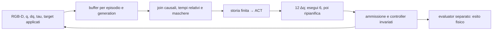

# ACT A1 temporal observations — maintained implementation

The temporal data path is implemented alongside the unchanged legacy recipe.
`policies/temporal.py` owns the shared causal builder and bounded incremental
buffer; `dataset/temporal.py` prepares independent frame-indexed streams and
builds history/target views lazily. `recording/temporal.py` is an opt-in recorder
for future complete collection. Existing recordings, checkpoints, physical
limits, teacher and collection lifecycle are unchanged.

Initial recipe: 4 seconds, 22 dynamic images plus one static reference, 241
measured-state slots (q9/dq9/tau7/previous applied target7), independent chunk 12
and execution horizon 6. Resolution remains provisional until the declared
60×96 / 120×192 / 240×384 saved-input GPU comparison is complete. Acquisition,
availability, generation, per-field masks and source indices are explicit.
Only relative support age/delay, measured values and masks enter the model.
Current commands are excluded; legitimate historical gaps are masked. Missing
feedback is distinct from measured zero. Torque requires a declared supported
source/order/units/sign; unverified hardware feedback remains unavailable.

Preparation defaults to diagnostic-only supervision. Explicit command-row
eligibility is required; chunks crossing ambiguous actions are rejected rather
than relabeled padding. Padding denotes absent targets beyond recorded support,
never a synthetic stabilization demonstration. Changing history or prediction
length reuses the same frame store. Legacy arrival times require an explicit
synchronous-simulation declaration and cannot establish hardware timing.

Implementation checks and measured costs will be recorded here after validation.
The design below is retained as the preimplementation contract and evidence;
its statements about work not yet executed describe that historical baseline.

---

# ACT A1 — osservazioni, storia causale e raccolta completa

**Historical design baseline (before implementation).** Verifica del 19 ottobre 2026 sul worktree `/home/pacquadr/.codex/worktrees/23f1/AlexDoor-XAS`, branch `PatrizioAcquadro/b1-policy-pilot`, baseline `825dd67`, albero inizialmente pulito. Analisi con un solo agente, senza simulazioni, dimostrazioni, inferenza, training o scelta di checkpoint.

L'obiettivo è completare il compito fisico da osservazioni proprie: acquisizione del contatto, apertura richiesta, mantenimento, rilascio e stabilizzazione reale. La somiglianza al teacher aiuta ad addestrare e diagnosticare; non sostituisce `PilotEvaluation`, i requisiti fisici o l'analisi dei rifiuti. Nessuna modifica alle soglie fisiche, alla calibrazione o al final test è implicita.

## Decisione iniziale

Usare **4 s di storia causale**, con `q9`, `dq9`, feedback di coppia `tau7` quando semanticamente verificato e precedenti target articolari realmente applicati. RGB-D a **120×192**, con l'attuale CNN condivisa come base: tre immagini recenti distanti 0.1 s, poi campioni ogni 0.2 s fino a 4 s, più un riferimento statico della stessa esecuzione. Sono **22 immagini dinamiche + 1 statica**. Il frame più recente proviene ancora dal flusso a 10 Hz. Stato e azioni precedenti restano a 60 Hz; il feedback nativo a 120 Hz viene conservato e unito causalmente al flusso di stato.

Mantenere inizialmente **`chunk_size=12` (0.2 s) e `n_action_steps=6` (0.1 s)**. Separare esplicitamente questi tre parametri. Una finestra finita con un piccolo aggregatore temporale basta come prima implementazione; non è richiesta ricorrenza. La risoluzione e i 4 s sono scelte iniziali motivate, non risultati di apprendimento. Un confronto successivo 2/4/6 s e un confronto di costo 60×96/120×192 devono poterle smentire.

## Evidenze riutilizzate e stato attuale

- [Learning audit](../../../outputs/evidence/act-a1-learning-audit-20261018/report.md) e [trace](../../../outputs/evidence/act-a1-learning-audit-20261018/pipeline-trace.md): input effettivo `4×5×60×96 + 9 + 9 = 115218`, CNN addestrabile, una sola osservazione aggregata, tre immagini recenti su 0.2 s. Le proposte di allora non sono il runtime corrente.
- [[../experiments/b1-act-a1-two-door-diagnostic|Diagnostico two-door]]: `0/2` successi, 6,238/368 comandi appresi, due fallimenti operativi completi, nessun retry. Apertura/hold a destra, nessun release; nessun contatto a sinistra. Le code sono censurate dai guard operativi: non identificano la storia corta come causa.
- [[../experiments/b1-act-a1-calibration-stopping|Closeout calibrazione/stop]]: correzione separata e verificata nelle regioni finite esaminate; 32 tentativi, 30 interpretabili, due fallimenti fisici originali e due tentativi di harness invalidi conservati. Usare in futuro il suo [runtime-recipe](../../../outputs/evidence/act-a1-calibration-stop-20261019/runtime-recipe.json), con calibrazione e `stop_stiffness` corrispondenti. Non conta come nuovo tentativo ACT, release o successo.
- [[../experiments/b1-data-pipeline|Data-pipeline closeout]] e migrazione `825dd67`: lavoro completato sui workload misurati. Preservare frame lossless riutilizzabili, join, letture limitate, cache limitate, prefetch di un batch, accesso ai raw e compatibilità legacy. H16/H64 riguardano lunghezze di azioni/sequenze di quei benchmark; l'osservazione resta quella da 115218 valori. Non misurano 4 s di storia visiva.

La [nuova analisi locale](../../../outputs/evidence/act-a1-observation-design-20261019/analysis.md) legge sette registrazioni dell'audit e i due rollout, senza cambiare le fonti. Cinque traiettorie training su due porte, due registrazioni development della stessa traiettoria sotto due luci: non sette moti indipendenti. Nessun accesso al final test.

## 1. Segnali: origine, registrazione, consumo e proposta

Ordine canonico `arm7`: `RIGHT_SHOULDER_Y`, `RIGHT_SHOULDER_X`, `RIGHT_SHOULDER_Z`, `RIGHT_ELBOW_Y`, `RIGHT_WRIST_Z`, `RIGHT_WRIST_X`, `RIGHT_GRIPPER_Y`. `observed9 = arm7 + NECK_Z + NECK_Y`. `RIGHT_GRIPPER_Y` è il settimo giunto del braccio, non l'apertura della ganascia WSG. Mappare per nome, mai assumere che gli indici dell'articolazione coincidano. Tutti questi giunti sono rotativi: rad, rad/s, N m, segno positivo della coordinata articolare.

| Segnale e semantica | Disponibile da robot/simulatore | Recorder/raw attuale | Prepared dataset e ACT deploy attuali | Proposta e trattamento |
|---|---|---|---|---|
| RGB e depth metrico assiale, validità | ZED simulata, `600×960`; hardware ZED: modalità/frequenza e sincronizzazione effettive non verificate qui | Expert `observations/{rgb,depth_m,valid_depth}` a 60 Hz; rollout `captures/*` a 10 Hz. RGB uint8, depth float32 m, valid bool; K e trasformazione ottica conservati | `RGBDEncoder`: pool 60×96, RGB/255, depth valido saturato a 5 m / 5 m, coverage; static a 25 s + 3 recenti a 10 Hz. Stessi input al deploy | Stesse cinque modalità/canali a 120×192, 23 frame con maschere per slot, tempi reali e validity coverage. Nessun crop guidato dal teacher, contact truth o maschera robot privilegiata |
| `q9` e `dq9`, stato misurato/simulato | `robot.data.joint_pos/joint_vel`; guida hardware: `OneDOFJointState.q/qd` | `observations` a 60 Hz; `robot_state` conserva anche tutti i 20 giunti e tool pose; `physics_feedback` conserva arm7 a 120 Hz | `FrameObservationWriter.proprio`: solo q9/dq9 correnti, 18 valori; `B1Observer` li concatena dopo le immagini | Sequenza 241×18 su 4 s a 60 Hz, compreso lo stato corrente. Neck necessario a contestualizzare camera/mobile view anche se ACT non lo comanda. Conservare full robot per diagnosi/FK, senza allargare l'input iniziale |
| `tau7`: feedback di coppia articolare | Sim: `root_view.get_dof_projected_joint_forces()`, proiezione della forza del solver sul DOF, `joint_output`; non forza esterna. Hardware: `tau` documentato, origine fisica e segno effettivo da verificare | `robot_feedback/{timestamp_s,available_s,torque_nm,present,healthy,source,semantics,reason}` a 60 Hz; `physics_feedback/torque_nm` a 120 Hz. Presente e healthy in tutte le righe dei sette episodi letti | Conservato nei raw referenziati/copied, **non** nei tensori di policy e non consumato da ACT; serve al monitor separato | Includere tau7 solo con unità, ordine, origine, segno e salute noti. Join del più recente campione disponibile per ogni stato a 60 Hz, senza media centrata. Maschera separata se assente/inaffidabile. Nessuna equivalenza automatica sim→hardware |
| `joint_effort_target`, `applied_torque`, corrente motore | Target di effort è comando; qui feedforward gravitazionale. `applied_torque` è effort calcolato/clippato dal modello attuatore verso il solver. La guida mostra chart corrente/tensione, senza un canale B1 acquisito | `commands/effort_target_nm` contiene il target, non la misura della coppia totale. `applied_torque`/corrente non sono un feedback registrato equivalente | Non consumati | Escludere dalla prima osservazione; conservare comandi effort se presenti. Non riempire tau mancante con target, torque calcolata o corrente convertita senza una calibrazione indipendente |
| Precedente target articolare applicato | Controller conosce target finale dopo limiter; non è posizione realmente raggiunta | Expert `commands/joint_target` arm7 e `neck_target`; rollout `commands/joint_target` full robot. Clock del comando pre-transizione. Il rollout conserva anche `request`, tipo/larghezza e flag learned | Target usati per label A1; nessuna storia di azioni come input | 240 eventi di comando arm7 precedenti; campionare il setpoint applicato `q_target_applied` rad nello stato storico. Per ogni stato, inserire l'ultimo target già consegnato, con maschera; ultimo comando mai dal futuro. La storia include anche veri comandi di pre-roll/inspection |
| Target richiesti, Δq richiesto, tool goal | Intenzione del teacher/policy prima dei limiti | Rollout conserva request e target applicati. Expert conserva tool goal e target articolare applicato; non ogni richiesta articolare pre-limiter è ricostruibile | A1 è `target_applied[j] - q_before[j]`; non goal del teacher nell'osservazione | Registrare entrambi per future label/diagnosi; prima policy consuma solo precedenti target applicati. Non usare richieste future o coda ACT come osservazioni |
| Carico modellato, `expected_torque_nm`, wrench/residuo | Dinamica del robot (`M·ddq + gravity + Coriolis`), Jacobiano e calibrazione; non misura di forza | `physics_feedback/{expected_torque_nm,jacobian_world,joint_acceleration}` e log del monitor | Monitor/admission, fuori dal vettore ACT | Restano fuori dall'input iniziale. Il limite inferiore/upper bound dipende da modello/calibrazione; non chiamarlo torque misurata. Un'eventuale ablation futura è un'altra decisione |
| WSG effort / wrist F-T / tactile | Schema `ft_states` documentato; installazione e canali di sensori F-T su questa configurazione non verificati. EZGripper della guida diverso da WSG32/UMI v1 | Nessun canale fisico WSG push-force/F-T verificato in B1 | Non consumati | Segnare unavailable. Nessuna forza di contatto inventata dal comando ganasce, modello o messaggio vuoto |
| Contact, phase, door angle/pose, `physical_valid`, progress, success | Simulator/evaluator truth, teacher e annotazioni; geometria osservata per il monitor è un ramo distinto | `annotations`, `evaluator`, trace separati; privilegiati anche se sincronizzati | Non sono input; phase usata per sampling/diagnosi. Geometria/calibrazione ammettono i comandi fuori da ACT | Esclusi dalla policy e dall'aggregatore temporale. Nessun timer di fase, percentuale di avanzamento, door ID/filename, label di contatto, comando di recupero del teacher o fallback privilegiato |

### Verifica hardware e limiti

L'[Alex003 Usage Guide, Alex ROS 2 Messages](https://docs.google.com/document/d/17QtexPK_RqmfRammA7CsvEUuhFZFkicrJfONCdlWkEg/edit?tab=t.hzxwf6up34le), letto direttamente il 19 ottobre, documenta `rt/alex_state`, QoS Reliable, `time: float64`, stati dei giunti con nome, `q` rad, `qd` rad/s, `tau` N m, temperatura e `is_operational`. La descrizione di `time` non stabilisce l'epoch/unità/clock-domain necessari al nostro adapter. Reliable non garantisce freschezza. La sezione SCS2 distingue desired/measured position, velocity, torque e mostra corrente/tensione.

`OneDOFJointCommand` contiene desired q/qd/tau e guadagni; `joint_control_type` è descritto come attualmente non usato: i setpoint vengono risolti con una legge PD in un desired motor torque. Non assumere un effort mode separatamente selezionabile. La guida non dimostra che `tau` provenga da un sensore di coppia in uscita anziché da una stima motore; non fornisce qui una caratterizzazione di bias, rumore, saturazione, filtro, latenza o rate effettivo. Non c'è un adapter hardware operativo nel repository: `PurdueIO.robot_feedback()` chiama `simulated_feedback`. Il pacchetto esterno `~/Desktop/Alex` integra gli asset/attuatori Isaac, non prova l'acquisizione ROS hardware.

Prima di utilizzare il canale su robot: confermare con l'interfaccia reale origine/scala/segno di tau, joint-name mapping, salute/saturazione, frequenza e clock, ritardo e filtri. Registrare ciò che arriva davvero. Fino ad allora la simulazione può usare il suo feedback `joint_output`; il profilo hardware deve mascherare il canale non verificato e non è qualificato per loaded operation dalla sola policy. Il monitor mantiene i propri requisiti indipendenti.

## 2. Tre parametri temporali indipendenti

| Parametro | Deploy verificato | Configurazione iniziale proposta | Significato |
|---|---|---|---|
| `history_s` | RGB recenti 0.2 s, 3 acquisizioni a 10 Hz; q/dq solo correnti; nessuna azione passata | 4 s: 22 recenti + 1 statica; 241 stati a 60 Hz; 240 azioni già applicate. 481 istanti teorici a 120 Hz compresi gli estremi, se presenti; non richiedere una riga nativa fittizia a t=0 | Informazione passata disponibile, indipendente dal numero di frame scelti |
| `chunk_size` | 12 azioni × 1/60 s = 0.2 s | 12 × arm7 Δq rad, 0.2 s | Futuro predetto, non storia |
| `n_action_steps` | 6 azioni × 1/60 s = 0.1 s, query a 10 Hz | 6, 0.1 s | Quanto viene eseguito prima della nuova query; ogni riga passa comunque i guard |

Le 12 azioni occupano 12 intervalli; gli start delle righe vanno da t a t+11/60 s. Analogamente 6 righe coprono 0.1 s, benché tra il primo e l'ultimo start intercorrano 5/60 s. `0 < n_action_steps <= chunk_size`; niente temporal ensembling attivo. I rate 60/120/10 Hz sono quelli dei clock simulati verificati: non attestano un controllo hardware alla stessa frequenza wall. Questi valori sono in [protocol.json](../../../outputs/evidence/act-a1-two-door-diagnostic-20261019/protocol.json), trace e comandi reali, non ricavati dai default di `ActModelCfg`.

Per le immagini usare gli offset **`[4.0, 3.8, …, 0.4, 0.2, 0.1, 0.0]` s**, oldest-first. Gli ultimi 0.2 s conservano la densità attuale; la parte più vecchia usa 5 Hz. La raccolta/restauro mantiene comunque i frame del flusso a 10 Hz, così densità e durata possono cambiare separatamente. Uno slot rappresenta un tempo desiderato, non un nuovo frame inventato: salvare il tempo effettivo del frame scelto. Proprio e azioni non vanno ridotte alla frequenza delle immagini: acquisizione del contatto e transitori di coppia possono essere più rapidi di 0.2 s.

Nei sette episodi: approach 6 s, contact 3 s, hold 3 s, release 6 s; push training circa 102–112 s, development 91 s. Sono durate del teacher osservate, non requisiti da codificare nella rete. Il contatto valido del primo teacher appare a 32.933 s, circa 1.07 s prima del push. La storia di 4 s può contenere l'ingresso in hold quando si decide il release dopo circa 3 s; 0.2 s spesso contiene soltanto pose quasi ferme. Quattro secondi non descrivono l'intera apertura né necessariamente tutta una release: l'evoluzione del task deve restare osservabile dallo stato corrente e dai suoi cambiamenti.

**Confronto successivo minimo: 2/4/6 s**, con stessa densità, dati, risoluzione, encoder, chunk e replanning. Sono rispettivamente 12/22/32 immagini recenti più la statica, 121/241/361 stati e 120/240/360 comandi passati. 2 s verifica se bastano transitori locali; 6 s verifica se l'inizio del hold/release esce dai 4 s. Non è una ricerca di architetture. Non ci sono registrazioni con hold variabile o reset intermedi per dimostrare già un optimum.

### Consumo delle sequenze da parte di ACT

Mantenere la CNN condivisa attuale come base, con la stessa semantica dei cinque canali e adattamento della sola dimensione spaziale. Ogni frame produce un vettore da 64 valori. Proiettare frame e righe robot a 128, con ruolo del canale e tempi relativi reali. Ogni riga robot contiene `q9 + dq9 + tau7 + previous_applied_target7 = 32` valori, più maschere e età disponibili. Sono 23 token visivi + 241 token robot = 264 token di storia.

Un solo piccolo blocco di attention temporale, dimensione 128 e 4 head, contestualizza questi token. Usare come readout il token dello stato corrente; il vettore risultante alimenta l'attuale ACT CVAE/chunk decoder. Nessuno stato nascosto persistente. L'attention può vedere tutta la finestra già passata, con key padding mask; non serve una maschera autoregressiva tra campioni tutti causalmente precedenti alla decisione. q/dq correnti restano espliciti nel readout. Non introdurre un nuovo backbone pretrained o una sweep RNN/TCN/Transformer.

Il frame statico ha un ruolo distinto: il suo tempo serve a validarne la provenienza, non diventa un contatore di progresso nella rete. Nessun tempo assoluto di episodio/teacher. I tempi relativi dei campioni dinamici descrivono età/distanze entro la finestra, non fase. Dati e checkpoint devono dichiarare questa ricetta come nuova, senza reinterpretare `rgbd-conv-v1` o riusare silenziosamente il suo checkpoint.

## 3. Contratto comune di campi e clock

Questi sono nomi di interfaccia proposti, non un nuovo sistema di manifest. Riutilizzare file HDF5, array e binding esistenti. Attributi fissi per episodio: joint order, unità/convenzioni, profilo sensori, K/mount/calibrazione e semantica del controller. Il nuovo builder deve restituire la stessa struttura in preparation e deploy.

| Campo logico | Forma/tipo e contenuto | Clock/supporto |
|---|---|---|
| `episode_id`, `generation` | Identità fisica esistente, intero locale di reset; mai feature | Un reset indipendente cambia generation anche se t torna a zero. Eventuali generation camera/controller devono corrispondere a quella attiva |
| `decision_time_s` | float64, secondi nel clock monotono dell'episodio | Istante di chiusura dello snapshot osservativo prima della prima azione del chunk |
| `images` | float32 `[23,5,120,192]`; RGB, depth/5m, coverage | 1 statica + 22 dinamiche, slot oldest-first; `image_valid[23]` bool. Invalidità di un frame distinta dalla mancanza di depth: RGB disponibile con coverage zero non inventa profondità, e il monitor geometrico decide separatamente se può operare |
| `image_acquired_s`, `image_available_s`, `image_source_index` | float64/float64/int64 per frame; indice -1 se assente | Acquired = esposizione/acquisizione; available = dati realmente pronti al builder dopo trasferimento/preprocessing senza pesi. Eventuale clock del device convertito in modo esplicito |
| `robot_history` | float32 `[241,32]`, q9/dq9/tau7/target7 | Slot a 1/60 s, compreso t; `q_valid`, `dq_valid`, `tau_valid`, `previous_target_valid`, tempi di origine/disponibilità per gruppo. Non richiedere simultaneità fittizia tra ROS e camera |
| `past_commands` raw | 240 intervalli su 4 s, target richiesto/applicato, dispatch time ed eventuale apply/ack time | Il target in `robot_history[j]` è l'ultimo già consegnato all'istante di quello stato. Può essere quello emesso nell'intervallo precedente; non il target che si sta per predire. Al bordo sinistro è ammesso il setpoint carry-in realmente noto prima della finestra, distinto dai 240 eventi di comando interni |
| `action_targets`, `action_is_pad` | float32 `[12,7]`, bool `[12]` | Solo training: azioni i…i+11, ciascuna riferita al q misurato immediatamente prima di quell'azione. Fuori episodio = padding, non dimostrazione di immobilità |
| `sample_age_s`, `availability_delay_s` | Tempi relativi per gruppi reali, non clock assoluto come input | `decision - acquired`, `available - acquired`; campi di supporto per audit e join. Passare età/missingness al modello dove il campionamento è irregolare |

### Regola causale e allineamento

1. Chiudere lo snapshot al tempo di decisione `t`. Per ogni slot `s <= t`, scegliere il campione della stessa generation con **`acquired <= s` e `available <= t`**, massimizzando acquired, con `0 <= acquired <= available <= t`. Non usare nearest-neighbor che possa prendere il futuro; non interpolare con campioni acquisiti dopo s. Questo descrive tutta l'informazione effettivamente disponibile a t.
2. Per lo slot corrente servono q/dq freschi; immagine recente con età entro l'attuale `max_gap_s=0.15`. Per uno slot storico, giudicare il ritardo di campionamento rispetto a s, non rispetto a t: un'immagine legittimamente vecchia 4 s non è automaticamente stale. Se il candidato camera dista oltre 0.15 s dallo slot, mascherare quello slot. Per q/dq/tau conservare il timeout iniziale di due tick (circa 33 ms) come limite di disponibilità, coerente con il monitor corrente; è una scelta operativa da misurare sul bridge, non una precisione fisica del sensore.
3. **Comandi passati più restrittivi:** per ciascuno stato storico s, inserire soltanto target già dispatched/applied a s, e disponibili entro t; un comando emesso dopo s non deve comparire lì. Al tempo t, l'ultimo comando passato è i-1. Se l'ack hardware è necessario per chiamarlo applied, usare l'ack; se conosciamo solo il setpoint consegnato al controller, dichiarare precisamente quella semantica, senza chiamarlo posizione raggiunta.
4. A1: `action[i] = joint_target_applied[i] - q_before[i, arm7]`. L'outcome di quella transizione è all'osservazione i+1. Al deploy ciascuna riga Δq viene aggiunta al **q effettivamente misurato al momento di eseguirla**, non cumulata sul q della prima query. Il limiter usa anche il target precedente; non cambia. Conservare pure l'intenzione richiesta per spiegare eventuali clipping.
5. In simulazione sincrona i dati verificati riportano acquired=available nel clock simulato; il tempo wall di calcolo è distinto. Il feedback nativo dopo l'azione i non può entrare nell'osservazione che l'ha scelta. In hardware acquisizione, arrivo, preprocessing e consegna del comando sono eventi diversi. Registrare clock-domain e conversione verso il tempo monotono comune, con il supporto di sincronizzazione effettivamente misurato. Se la conversione di clock non è verificata, il campione non è causalmente utilizzabile. Un ritorno indietro del clock invalida il flusso fino a reset; campioni tardivi conservano il vero available, i duplicati non diventano nuove acquisizioni.
6. Durante inferenza asincrona lo snapshot resta immutabile. Timestampare query-ready, fine inferenza e dispatch. Prima del primo comando rivalidare lo snapshot rispetto al tempo effettivo; se non è fresco scartare il chunk. In prima implementazione non eseguire righe con start previsto già passato per “recuperare il ritardo”: ripianificare/fermare secondo l'IO esistente. Se il costo non consente il rate, misurarlo prima di autorizzare deploy; latency compensation futura richiede identica regola nei label. Nessuna riduzione nascosta della frequenza.

Per riprodurre una decisione già salvata, usare le sue disponibilità a t; non far entrare un campione arrivato successivamente solo perché ora è nel file. Dati legacy senza clock di arrivo hardware non possono dimostrare quel comportamento asincrono. Per i record sincroni esaminati la coincidenza è dichiarata dalla sorgente, non dedotta dalla velocità di lettura del disco.

### Missingness, normalizzazione e warmup

- Raw: conservare NaN, mask, sample assenti e motivo. Tensor: zero numerico solo dopo normalizzazione e con `valid=False`; non dire “coppia zero” quando la misura è assente. Per q/dq e target usare unità fisiche come oggi; per tau usare scale per giunto fitted solo sui dati training ammessi e healthy, senza il vecchio clipping generico ±10 applicato ciecamente ai N m. Non adattare scale su development/test; non comprimere anomalie in un valore nominale silenzioso. Controlli hard e salute restano separati dalla normalizzazione.
- Maschera per campo e per token: tau può mancare con q/dq presenti. Un token senza dati validi viene escluso dall'attention. q/dq o immagine corrente essenziale mancanti rendono la query indisponibile; una lacuna storica isolata non deve causare automaticamente un arresto. Il monitor può comunque richiedere feedback di carico fresco per ammettere movimento.
- Ripetere lo stesso ultimo frame per due slot è lecito se è davvero la migliore misura disponibile: mantenere lo stesso source index e acquired, senza fingere due acquisizioni. Un frame mancante prima del reset resta masked, non replicato con un tempo antico inventato.
- `history_s` non è warmup obbligatorio. Conservare inizialmente il warmup comune da 0.2 s e i requisiti di freschezza/inspection esistenti; non attendere 4 s a contatto senza giustificazione. Il primo campione eligible di training deve coincidere con la stessa condizione di readiness usata nel deploy. Oggi la preparation parte da 25.0 s e il rollout impara da 25.2 s: conservare il prefisso per contesto e applicare il criterio condiviso, senza cancellare i vecchi risultati.

### Episodi completi, crop e reset intermedi

Tenere separati tre casi:

- **Episodio completo:** azioni N e osservazioni N+1, con tutto il pre-roll/inspection realmente registrato. Escludere le azioni di inspection dalla loss quando previsto, ma renderle disponibili come storia applicata. A fine episodio mascherare i target oltre N; non sostituirli con presunti esempi post-release.
- **Crop intermedio di una traiettoria continua:** può usare il vero prefisso dello stesso episodio, con clock e comandi originali; non è un nuovo reset fisico né una dimostrazione indipendente. Può essere anche addestrato con prefisso deliberatamente unavailable per esercitare lo stesso warmup corto del runtime; questa è una maschera di osservazioni disponibili, non la creazione di stati/azioni.
- **Reset fisico indipendente in fase intermedia:** svuotare immagini, stato, target precedenti, aggregatore e coda ACT; cambiare generation in tutti i produttori. Ripristinare q, dq, target, controller/gains e cinematica coerenti; stato porta/contatto/velocità e solver devono essere fisicamente compatibili. Ricalcolare camera/collision transforms prima di physics, come insegna il precedente harness invalido. Preferire raggiungere lo stato mediante un pre-roll reale qualificato. Un'istantanea con giunti copiati non ricrea precarico elastico, contatto, velocità o storia.

Il pre-roll reale del nuovo reset può diventare storia; il prefisso della vecchia traiettoria da cui è stata copiata la posa non può. Se manca pre-roll, inserire solo osservazioni realmente prodotte dopo il reset, con maschere a sinistra. Il target iniziale del controller è stato noto del reset, non una lista di comandi “già applicati”: prima azione passata invalida finché non è stata emessa davvero. Se non è possibile mantenere fisicamente quel reset durante il warmup, il reset non è pronto per la policy. Il gruppo di split resta quello della famiglia di traiettorie sorgenti; una generation nuova non crea indipendenza statistica.

## 4. Esempi causali dai dati salvati

Gli indici sotto appartengono al raw `animated-door-1-88abf40-dim-real-pilot`, primo episodio dell'audit. Il [JSON numerico](../../../outputs/evidence/act-a1-observation-design-20261019/analysis.json) contiene tutti i 22 source index e clock per ognuno degli otto esempi, oltre a q/dq/tau e primo target. La colonna “futuro” è supervisione separata, mai input.

| Caso salvato | Decisione/raw row | Storia proposta ricostruibile | Futuro/limite |
|---|---|---|---|
| Reset episodio | 0 s / 0 | 1/22 frame recenti e 1/241 stati reali; static assente, nessun comando precedente | 12 comandi raw presenti, ma sono inspection; non una query manipolativa eligible |
| Primo stato manipolativo registrato | 25 s / 1500 | Storia reale 21…25 s, 241 stati, comandi 1260…1499; ultimi frame 24.8/24.9/25.0; static 25.0 | Target 1500…1511 presenti. Readiness deploy corrente è 25.2 s; non nascondere la differenza |
| Contact acquisition, annotata offline | 32.933 s / 1976 | Ultimi frame 32.7/32.8/32.9, ultimo disponibile vecchio 33 ms; precedenti comandi 1736…1975 | Target 1976…1987. Tra 32.917 e 32.933 s immagini correnti identiche, ma Δq misurata max 0.655 mrad e Δdq max 0.0277 rad/s; non sono input completi identici |
| Contact→push | 34 s / 2040 | Frame finali 33.8/33.9/34.0; 241 stati e comandi 1800…2039, inclusa l'acquisizione reale del contatto | Target 2040…2051; nessun “phase=push” nel tensore |
| Push nominale | 75 s / 4500 | Storia 71…75 s; comandi 4260…4499; frame 74.8/74.9/75.0 | Target 4500…4511 |
| Push→hold | 136.483 s / 8189 | Ultimi frame 136.2/136.3/136.4, age 83 ms; comandi 7949…8188 | Target 8189…8200. La finestra mostra la decelerazione, non un flag hold |
| Hold→release | 139.483 s / 8369 | Storia da 135.483 s contiene ingresso hold a 136.483 s; frame finali 139.2/139.3/139.4; comandi 8129…8368 | Target 8369…8380. Stesse immagini rispetto al tick precedente; q cambia comunque di 0.581 mrad. Non è dimostrata impossibilità di osservare la decisione |
| Fine release registrata | 145.483 s / 8729 | Ultimi frame fino a 145.4, 240 comandi passati reali | Nessun comando futuro; 12 target padding. Nessun campione di normale stabilizzazione successiva nel raw |

Nei rollout two-door il clock verificato è 60 Hz controllo, 10 Hz capture e 120 Hz feedback, con generation 2 costante dall'inizio alla fine. La prima query learned a 25.2 s usa realmente static 25.0 e recenti 25.0/25.1/25.2; la storia estesa può usare il vero pre-roll 21.2…25.2, non azioni immaginarie. Right termina a 129.167 s, ultimo frame 129.1; left a 31.333 s, ultimo frame 31.3. Sono terminali operativi senza target successivo, non esempi di release riuscita.

**Evidenza mancante:** nessun reset fisico intermedio con pre-roll documentato; nessun episodio con hold variabile; nessuna coda dedicata RGB-D/azioni ACT o teacher di normale stabilizzazione dopo il completamento del segmento di release. Il distacco può avvenire durante la release registrata: non si sostiene che manchi ogni osservazione dopo la separazione. Le loro regole sopra sono specifiche da verificare in seguito, non esempi già misurati. Il file separato `post-stop.npz` verifica una risposta di arresto, con controller e finalità diversi.

## 5. Cosa deve preservare la futura raccolta

Registrare **l'intera traiettoria sincronizzata**, non finestre già tagliate sulla ricetta iniziale. Il contratto minimo è:

1. RGB uint8, depth metrico e validità lossless a cadenza dichiarata **almeno 10 Hz per questa proposta**, K e trasformazione camera/robot, acquired/available, tutto il pre-roll e la coda finale. Le registrazioni esistenti a 60 Hz restano intatte. Salvare tutti i frame del flusso di raccolta scelto, non solo i 23 slot usati da un particolare sample. 10 Hz consente di cambiare storia, chunk/replan e le densità qui proposte; non consente di rivendicare una successiva analisi visiva a 60 Hz. Se quella domanda è prevista, mantenere anche i frame nativi a 60 Hz e stanziarne il costo.
2. q/dq observed9 e full-robot state a 60 Hz; tau e feedback supportato **a ogni sample nativo rilevante, oggi 120 Hz in sim**, senza scartarli una volta ottenuta una media. Source, units, order, health e clock a granularità necessaria; nessuna disponibilità hardware inventata. Tool pose misurata/calcolata da stato robot conservata per diagnosi e target futuri, senza porta truth nelle osservazioni.
3. Per ogni comando: tempo di richiesta, tipo/azione desiderata, target articolare richiesto prima dei limiti, target finale consegnato, applicazione/ack quando disponibile, eventuale clipping/rifiuto e stato q_before corrispondente. Conservare neck/gripper target e effort feedforward effettivamente inviati. Ogni comando emesso durante pre-roll, release e stabilizzazione deve comparire. Azione rifiutata ≠ target applicato.
4. `q_target_requested`, `q_target_applied`, `q_before` consentono in seguito target assoluti e delta senza recollection. A1 rimane **`A1_joint_delta`**, non cambia in posizione assoluta. Per altri spazi mantenere tool actual/requested/applied, frame/calibrazione già previsti; non qualificare A3/A4 per poter raccogliere A1.
5. Annotazioni di phase/contact/door, evaluator e outcome separati, con tempo; complete/interrupted/termination distinti da task success. Conservare fallimenti, rifiuti e sample ambigui senza cambiare gli esiti storici. La fine file non è una label “stop”.
6. Proseguire, a ritiro di release completato e con **rilascio fisico effettivo**, con normali target di stabilizzazione e acquisizione, fino a coprire l'assestamento e una finestra dichiarata di osservazione. Come minimo iniziale usare 2 s di osservazione dopo il completamento del rilascio/ritiro, prolungando se il transiente non è finito; è una scelta di copertura che riprende la scala della verifica esistente, non una nuova soglia di successo. Solo dopo può avvenire l'eventuale arresto di sicurezza finale separato. Mai sostituire il tratto con `freeze_motion`, zeri o ripetizioni sintetiche. Se interviene un safety stop, conservarlo come tale.

Cambiare `history_s`, `chunk_size` e `n_action_steps` deve richiedere al massimo nuove viste/join e maschere, non una nuova acquisizione delle parti già adeguate. Acquisizione e recording non devono essere troncati al confine della vecchia history o al primo frame di release. La cadenza massima acquisita rimane un limite reale; nessun formato può recuperare dati mai registrati.

### Cambiamenti richiesti al teacher, in un incarico successivo

- Estendere la dimostrazione alla stabilizzazione normale post-release e registrare anche quel controllo. Oggi `run_probe` termina dopo la release e finalizza il recorder; `pilot_physics.py` esegue poi un `verify_stop_continuation` separato. Serve un solo ciclo di vita di registrazione completo, con conclusione finale dopo la coda ordinaria; lo stop rimane distinto.
- Conservare richieste prima dei limiter oltre ai target applicati, native feedback e clock descritti sopra. Separare eventualmente RGB-D a 10 Hz dagli stati a 60 Hz nel nuovo recorder; il recorder expert attuale impone una riga RGB-D per stato. Non cambiare quel comportamento in questo incarico.
- Dimostrare tutte le transizioni, inclusi ingresso in contatto, contatto→push, push→hold e hold→release, con continuità del comando. Durate possono variare con condizioni osservabili, geometria, ingresso nel contatto e assestamento, mantenendo i requisiti minimi del compito. Non scegliere release time casuali dopo finestre osservativamente indistinguibili: la sola variazione dei timer rende la supervisione contraddittoria. Il teacher può usare i suoi strumenti per qualificare/annotare; i suoi timer, phase e progress non diventano input.
- Per eventuali recuperi: definire il disturbo osservabile e registrare una risposta fisicamente riuscita con pre-roll vero. Non riciclare automaticamente i fallimenti della policy come expert action. I **68 sample weak-load in 26 intervalli** del right+ falliscono il criterio di load filtrato, non gap/material/footprint: mantengono le annotazioni originali e richiedono un giudizio training-only prima di ammetterli come supervisione; non sono recovery qualificati. Per il nuovo expert set, tenere diagnostic-only i target ambigui finché una revisione esplicita non li ammette: escludere inizialmente le finestre supervisionate il cui chunk li interseca, senza rinominarli padding o alterare il raw. Le osservazioni reali precedenti possono ancora essere contesto di target successivi qualificati. Nessuna maschera nuova viene applicata oggi.

### Registrazioni riutilizzabili e split

I sette raw dell'audit hanno traiettorie RGB-D a 60 Hz, q/dq e feedback torque completo per i tratti presenti. Sono riutilizzabili per storia 2/4/6 s, risoluzione derivata, target A1 applicati e confronti di transizione entro tali tratti; non serve ricollezionarli per cambiare soltanto la finestra. La vecchia richiesta articolare pre-limiter e la coda dedicata di normale stabilizzazione non sono recuperabili se non furono registrati. Record senza tau rimangono validi per le altre modalità con tau masked, senza promozione a loaded qualification. Le viste prepared attuali sono compatibilità/cache, non la fonte unica per il nuovo builder.

I due rollout falliti restano diagnosi e valutazione, fuori dall'expert imitation per default. Stesso trattamento per interruption e vecchie dimostrazioni già escluse per handoff difettoso. L'eleggibilità globale dei vecchi episodi e tutti i risultati storici restano quelli originali; una nuova selezione di label è esplicita e prospettica.

Split per identità porta come congelato; dentro ogni identità mantenere **tutti** i rerender/luci, perturbazioni correlate, crop, pre-roll, recuperi e reset da una stessa traiettoria nel medesimo gruppo train/development. Non dividere per finestre, frame o generation. Le due luci development attuali valgono un moto. Statistiche solo training. Development per scelte e transizioni; final test sigillato, nessun tuning di finestre/risoluzione/checkpoint con esso. I precedenti obiettivi 44 training + 8 development sono una proposta di copertura non eseguita, non un obbligo di questa specifica né un budget già disponibile.

## 6. Qualità informativa e costo pratico

Ispezionati gli [input effettivi salvati](../../../outputs/evidence/act-a1-learning-audit-20261018/training-model-inputs.png) e il [confronto locale dei dettagli](../../../outputs/evidence/act-a1-observation-design-20261019/event-detail.png) attorno ad acquisizione, push, hold e release. Quest'ultimo è una preview numerica da raw e pooling, non una misura di performance del modello a 120×192. Il crop centrato sul tool viene da FK solo per analisi; non è input proposto.

60×96 conserva scena, posa grossolana di porta/braccio e movimento, ma il pooling 10×10 mescola bordo, dito e pannello. Alla profondità ottica del tool nei cinque frame (circa 0.70–0.87 m), una distanza laterale pinhole di 10 mm proietta 4.25–5.26 pixel nativi: **0.42–0.53 pixel a 60×96**, 0.85–1.05 a 120×192. Per 3 mm sono circa 0.13–0.16 e 0.25–0.32 pixel. È una stima geometrica, non la visibilità di un gap reale: orientamento e occlusione possono peggiorarla. Neppure 120×192 certifica contatto millimetrico; coppia e dinamica proprie possono aiutare. Non è dimostrato che la risoluzione sia la causa dei fallimenti.

| Costo calcolato, float32 | 60×96 | 120×192 raccomandata inizialmente |
|---|---:|---:|
| Frame RGB-D/coverage a 5 canali | 0.110 MiB | 0.439 MiB |
| Input immagini batch 8, 23 frame | 20.2 MiB | 80.9 MiB |
| Input storico robot batch 8, 241×32 | 0.24 MiB | 0.24 MiB |
| Pooled frame store a 10 Hz, 150 s, senza compressione | 165 MiB | 659 MiB |
| Matrice attention 264 token, 4 head, batch 8, una matrice float32 | 8.5 MiB | 8.5 MiB |

Sono stime di array, non picchi di VRAM/RSS né throughput. A 120×192 le sole uscite dei tre conv layer, per 23×8 immagini, occupano circa 113 MiB se conservate una volta; autograd, normalizzazione, workspace, optimizer, CVAE e copie possono moltiplicare il costo. Batch 32 moltiplica per quattro gli array dipendenti dal batch. I circa 94.5 MiB CUDA del precedente benchmark batch 8 non stimano questo modello temporale.

Raw RGB uint8 + depth float32 + valid bool a 600×960: circa 4.39 MiB/frame, 43.9 MiB/s a 10 Hz, **6.44 GiB per 150 s**; a 60 Hz circa **38.6 GiB**. Sono payload non compressi prima di overhead/risultati: non un valore misurato sui file LZF. Feedback robot a 120 Hz è piccolo in confronto alle immagini. Una proposta da 52 cicli da 150 s costerebbe circa 335 GiB raw a 10 Hz o 2.0 TiB a 60 Hz, prima di fallimenti, overhead e copie. La precedente proposta di conteggi richiede quindi un budget di raccolta separato.

Online: il ring raw di 4 s a 10 Hz richiede circa 180 MiB, più una statica; i 23 input a 120×192 circa 10 MiB/query. La CNN vede circa **23 volte** il lavoro visivo del vecchio input 4×60×96 (frame count × area), non 23 volte il tempo dell'intero sistema. La nuova attention e i join aggiungono costo; non trasformare questa proporzione in una previsione di ms.

Riutilizzare frame lossless e preprocessing senza pesi, con source index per finestra; niente espansione dei frame per ogni tick/ogni H. Deduplicare le letture dei frame in ogni batch e ripristinare l'ordine del sampler. Cache limitata e un batch prefetch come oggi. **Nessuna cache persistente di output di un encoder addestrabile:** i pesi cambiano e servono gradienti. La fattibilità online iniziale deve essere misurata ricomputando l'intera finestra; eventuale riuso durante inferenza con pesi congelati è un'ottimizzazione separata, non una premessa per far tornare il costo. Non materializzare l'intero corpus/VDS in RAM.

### Confronti successivi minimi, in ordine

1. **Costo prima di apprendimento/collection:** stessa storia 4 s, stessi frame salvati, medesima CNN e batch 8; confrontare solo 60×96 e 120×192. Un passaggio reale preparation→loader→forward/backward GPU senza optimizer update e un replay online di query con stato immutabile, includendo preprocessing/transfer, primo accesso e regime. Una breve misura isolata per configurazione; ripetere soltanto se c'è contesa o variabilità non risolta, conservando tutti i tentativi. Misurare RSS/VRAM, numero di frame letti, batch/query p50/p95 e massimo, età al dispatch, deadline di controllo e code. Per il runtime la query deve rispettare il replan di 0.1 s e mantenere freschezza/controllo; una media bassa non basta. Nel percorso sincrono che chiede un nuovo chunk a coda vuota, occorre anche consegnare il primo target entro il prossimo tick di controllo (circa 16.7 ms per tutto il percorso sul clock wall fisico). La simulazione che sospende il proprio clock durante il calcolo non dimostra questo limite. Un eventuale scheduling asincrono è una modifica separata con alignment e disponibilità da verificare, non un modo implicito per superare il gate. Questo confronto non è autorizzato oggi.
2. Se il costo passa, breve confronto appreso sulla stessa nuova raccolta, 60×96 vs 120×192, con stessi split, esposizione ai dati e criteri. Nessun encoder nuovo soltanto perché recente. Soltanto se entrambe le opzioni non conservano il dettaglio utile o non consentono il rate, aprire una scelta separata di un encoder/crop sensor-only mantenuto e motivato. Nessuna sweep di backbone in questa fase.
3. Fissata la scelta visiva, confrontare 2/4/6 s, variando solo la durata. Conservare chunk 12/replan 6; valutarli separatamente solo dopo una ragione misurata. Offline: transizioni, primi sei target eseguiti e tutti i dodici, tail/missing/warmup e gruppi indipendenti, con unità fisiche. Errori teacher e loss sono diagnostici. In closed loop: completamento fisico intero e componenti, numero di tentativi, rifiuti senza violazione, violazioni, contatto perso, release e normale stabilizzazione. Confrontare anche false refusals; non promuovere opening/hold o stop sicuro a task success.

Il protocollo successivo deve dichiarare esposizione/budget e stopping prima dei run. Nessun nuovo target numerico di loss è inventato per scegliere un vincitore; usare criteri fisici già fissati e variabilità development, preservando tutte le prove. I benchmark H16/H64 restano evidenze d'infrastruttura sui propri workload.

## 7. Implementazione successiva: ordine e acceptance

Checklist minima, **non eseguita da questa specifica**:

- [ ] **1. Nuovo observation binding e builder condiviso.** Parametri indipendenti history/offsets/rates, chunk/replan separati, campi/maschere/clock sopra. Rimuovere dalle nuove ricette gli assunti `HISTORY=3`, `features[:-18]`, `proprio.shape=18` e quattro `image_indices` fissi in `encoding.py`, `policies/observations.py`, `common/b1_contract.py`, `common/visual.py`, `dataset/storage.py` e `recording/rollout.py`; lasciare leggibile la ricetta legacy. Acceptance: stesso sample raw → stessi tensori, clock, indici e maschere offline/live; rifiuto esplicito di vecchio checkpoint con nuovo input.
- [ ] **2. Causal join e reset.** Usare stato/feedback nativi e target applicati, generazioni indipendenti e readiness comune. Acceptance: esempi salvati in questa pagina riprodotti; campione futuro o arrivato tardi, clock incompatibile, gap e reset non contaminano la finestra; missing tau resta distinta da zero. Mutare soltanto annotazioni privileged non modifica alcun tensore di policy. Cambiare il comando corrente/futuro non modifica la storia di quella decisione.
- [ ] **3. Storage/reader e training sample completi.** Frame store indicizzato, proprio/azioni indipendenti, letture bounded e prefetch esistente; history indipendente da target H. Acceptance: nominale, transizione, boundary e ordine batch/duplicati; 2/4/6 s e H12/H64 cambiano viste senza duplicare raw o frames; nessun crossing episodio/generation; is_pad maschera solo target assenti e non crea azioni di stop; peak RSS dipende dal batch/cache, non dal corpus intero. Non ripetere l'intero vecchio studio prestazioni.
- [ ] **4. Aggregatore temporale e runtime.** CNN condivisa + singolo blocco finito; stessa semantica A1 e per-row admission, no recurrence necessaria. Acceptance: padding ignorato, gradienti arrivano all'encoder attuale su frame reali, nessun latent addestrabile in cache; misura del confronto di costo sopra e integrità di controllo/replan. Nessun deploy se i deadline non sono rispettati.
- [ ] **5. Recorder e teacher completi.** Richiesto/applicato, native feedback, clock reali, pre-roll e stabilizzazione normale. Acceptance prima di una raccolta estesa: un episodio completo include tutte le transizioni e coda reale; un reset intermedio qualificato dimostra stato fisico e storia onesti; un fallimento/interruzione è recuperabile senza trasformarlo in expert supervision. Requisiti fisici e stop profile/calibrazione invariati; nessuna penalizzazione nascosta per semplice distanza dal teacher.
- [ ] **6. Ammissione dati e valutazione.** Gruppi indipendenti, quality mask prospettica per weak-load/failure, statistiche train-only, development comprendente mixed-phase windows e tail. Acceptance: tutte le derivazioni della stessa traiettoria nello stesso split; `68` ambigui e risultati precedenti ancora recuperabili; final test non letto. Solo dopo questo punto, raccolta/training/confronti e checkpoint selection richiedono il loro incarico.

## Questioni ancora aperte

Origine/latency/filtri e validazione fisica di tau hardware; capacità di 120×192 più feedback di risolvere gli eventi difficili; costo reale della nuova finestra; migliore durata 2/4/6 s; osservabilità del momento di release sotto durate variabili; reset intermedi e coda normale post-release ancora non acquisiti. La proposta evita di risolvere questi dubbi con timer di fase o truth. Se due storie sensoriali realisticamente indistinguibili richiedono azioni opposte, cercare prima una specifica/collezione causalmente coerente o una misura disponibile; più storia o una RNN non sono una prova di soluzione.

## Fonti primarie e applicazione limitata

La [review locale precedente](../../raw/docs/03_LitReview.md) motiva la separazione tra rappresentazione spaziale e astrazione temporale e l'importanza di episodi matched; non dimostra un valore di storia per AlexDoor. I collegamenti seguenti sono stati riaperti nella presente analisi:

- [ACT, paper §IV-A](https://arxiv.org/html/2304.13705v1) e [ALOHA, autori](https://tonyzhaozh.github.io/aloha/): action chunking e temporal ensembling sono strumenti del metodo pubblicato; la nostra implementazione usa chunking ma non ensembling. La finestra finita proposta non è un risultato del paper.
- [Diffusion Policy, autori](https://diffusion-policy.cs.columbia.edu/): la predizione di sequenze con esecuzione receding horizon giustifica concettualmente distinguere prediction horizon e execution horizon, senza cambiare ACT in Diffusion o importarvi i default.
- [UMI, autori](https://umi-gripper.github.io/): l'interfaccia include latency matching e gli autori mostrano conseguenze del disallineamento in un loro task dinamico. Questo sostiene la necessità dei clock; non dimostra lo stesso effetto o la stessa soluzione per Alex003. La loro ablation di encoder è specifica al loro task, non un motivo sufficiente per adottare un ViT qui.
- [Alex003 Usage Guide](https://docs.google.com/document/d/17QtexPK_RqmfRammA7CsvEUuhFZFkicrJfONCdlWkEg/edit?tab=t.hzxwf6up34le): semantica documentata dei messaggi, con i limiti hardware esplicitati sopra.

Sorgenti eseguibili principali: [encoding](../../../src/alexdoor_xas/policies/encoding.py), [observer](../../../src/alexdoor_xas/policies/observations.py), [feedback/load](../../../src/alexdoor_xas/perception/load.py), [expert recorder](../../../src/alexdoor_xas/recording/b1_runtime.py), [rollout writer](../../../src/alexdoor_xas/recording/rollout.py), [preparation](../../../src/alexdoor_xas/dataset/b1.py), [storage](../../../src/alexdoor_xas/dataset/storage.py), [sampler](../../../src/alexdoor_xas/dataset/sampling.py), [ACT](../../../src/alexdoor_xas/policies/act/model.py), [teacher](../../../src/alexdoor_xas/qualification/synthetic_probe.py), [collection lifecycle](../../../scripts/pilot_physics.py). Code e record stabiliscono lo stato attuale; le sezioni propositive non sono capability già disponibili.
