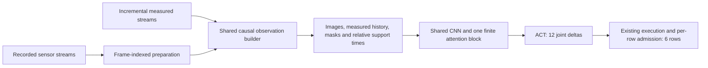

# ACT A1 observations and time

The finite-history data-to-ACT path is implemented and CUDA checked. It is an
explicit new observation/checkpoint recipe alongside the maintained legacy path.
No teacher, controller, admission, physical requirement, historical recording,
checkpoint or final-test data was changed. No optimizer update, demonstration,
physics simulation or checkpoint selection was performed.

The objective remains physical contact acquisition, required opening, hold,
release and normal stabilization. Offline agreement and teacher imitation do
not establish any of these outcomes. The original design is retained in Git at
`da04d38`; its saved analysis and prior negative results remain unchanged.

## Initial configuration

Use **4 s, 120×192 RGB-D, the existing shared CNN architecture, chunk 12 and
execution horizon 6** as the initial implementation baseline. These are
independent settings, not learned optima. Use full visual recomputation by
default; inference reuse is optional and its measured limits are below.

| Setting | Initial value | Independent meaning |
|---|---|---|
| `history_s` | 4 s | Available past support; not a required 4 s warmup |
| `image_offsets_s` | Oldest first: 4.0, 3.8, …, 0.4, 0.2, 0.1, 0 s | 22 dynamic slots, plus one static inspection reference |
| `state_hz` | 60 Hz | Robot-history sampling density; changing it does not change action timing |
| `control_dt_s` | 1/60 s | Recorded action interval; no implicit rate change |
| `chunk_size` | 12 | Predicted future A1 rows |
| `n_action_steps` | 6 | Rows to execute through existing per-row admission before replanning |

The default history has 23 images and 241 robot tokens. Each robot token contains
q9/dq9/tau7/previous applied target7, four field masks and support ages/delays.
The static endpoint remains 25 s for the existing inspection recipe, with 0.2 s
warmup and shared current-data readiness. A new reset must supply its own real
inspection/pre-roll and generation; it cannot borrow the source trajectory's past.

## Maintained interfaces



- [Shared builder](../../../src/alexdoor_xas/policies/temporal.py):
  `TemporalConfig`, `CausalObservationBuilder`, `IncrementalObservationBuilder`.
- [Preparation and sampling](../../../src/alexdoor_xas/dataset/temporal.py):
  `prepare_temporal`, `TemporalEpisode.training_rows`, `sample`, `batch`, `batches`.
- [Temporal ACT](../../../src/alexdoor_xas/policies/act/temporal.py):
  `temporal_model`, `fit_temporal_stats`, `normalize_temporal_batch`,
  `save_temporal_policy`, `TemporalActPolicy.from_checkpoint` and `predict`.
- [Future recorder](../../../src/alexdoor_xas/recording/temporal.py):
  `TemporalRecorder.state/capture/feedback/command/annotate/finish/close`.
- [Cost harness](../../../scripts/benchmark_temporal_act.py): saved-input
  preparation, loading, native preprocessing, inference and backward-only checks.

The CNN is exactly the maintained `rgbd-conv-v1` architecture: five channels,
three convolutions, GroupNorm and the 3×4 spatial grid. One finite attention block
contextualizes image and robot tokens. The **current measured-state token** is
the readout, with current q/dq also passed explicitly to its projection. There is
no recurrent hidden state, privileged crop or temporal action ensemble.

ACT accepts structured batches through recursive `collate_torch` and the existing
ACT training interface. `obs_dim=32` denotes measured feature width, not a flat
image vector. Temporal checkpoints bind preprocessing/history, joint order,
robot identity, A1 semantics and execution horizon. Their format is
`b1.act.temporal.v2`; legacy checkpoints and flat observations cannot silently
enter this recipe. Legacy model/checkpoint behavior remains supported separately.
The simulator's legacy observer is not automatically switched to this new path.

### Preparation and consumption

Read `depth_interval_m` from the recording's calibration; do not replace its
validity interval with the 5 m normalization/saturation scale. For a legacy
simulation file, the explicit `legacy_synchronous=True` declaration acknowledges
that hardware arrival clocks were never recorded.

```python
cfg = TemporalConfig(depth_interval_m=recorded_depth_interval)
prepare_temporal(source, prepared, cfg, eligible=reviewed_command_mask,
                 legacy_synchronous=True, device="cuda:0")
with TemporalEpisode(prepared, cfg) as episode:
    rows = episode.training_rows(horizon=12)  # numeric support; no image reads
    stats = fit_temporal_stats([episode])    # unique training episodes only
    batches = (normalize_temporal_batch(batch, stats)
               for batch in episode.batches(rows, batch_size=32, horizon=12))
    # batches feed the existing ACT tensor interface; no training is run here.
```

`reviewed_command_mask` is required to admit supervision. Its default is all
false, including for failed/interrupted/ambiguous recordings. Chunks intersecting
an ineligible real command or an internal target hole are excluded. True tail
padding marks absent targets, never fabricated zero-action stabilization. A
terminal observation can be ready sensory context while having no expert target.
Inspection and other rejected actions may remain real historical context.

Training normalization fits action statistics and supported healthy tau only on
explicitly admitted training rows. q/dq and previous targets retain physical
units. Missing values are zero after normalization with separate false masks;
constant tau channels keep unit scale rather than amplifying numerical noise.
No generic ±10 clipping is applied to measured N m. Dataset grouping remains by
frozen door/trajectory family; rerenders, crops, recoveries and reset derivatives
must stay in their source group's split. No final-test reader is authorized.

## Causal, reset and storage contract

For historical slot s at decision t, select the latest same-generation acquisition
with `acquired <= s`, `available <= t` and verified episode clock conversion.
A previous applied target additionally requires **dispatch < s** and application/
availability no later than s. The command at t and all requested/future targets
are excluded. A1 labels remain applied target minus measured q immediately before
that command. Each executed delta must still be added to the q measured for its
own execution row by the existing action adapter.

The static image's learned age is the constant `-1` role marker; its arrival
minus acquisition delay remains relative support. Recent images retain their
relative ages and delays. Absolute static acquisition/arrival timestamps remain
outside learned inputs for alignment and diagnostics. The revised temporal v2
checkpoint format prevents silently reinterpreting experimental v1 weights;
legacy flat ACT/Diffusion checkpoint formats are unchanged.

Current q/dq and a recent image are required. Historical gaps are masked, not
turned into automatic refusal. The initial image gap allowance is 0.15 s; state/
feedback support uses two control ticks. These are operational freshness choices,
not physical precision or hardware qualification. RGB with unavailable depth can
remain an image with zero depth coverage. Invalid historical image tokens are
masked. Clock regression on ingress invalidates it until reset; unconverted clock
domains are rejected. Reset clears static/history/targets and inference features.

Torque must have declared origin, semantics, named arm7 order, N m units, positive
joint-coordinate sign and health. Legacy simulated `joint_output` is solver DOF
feedback, not external contact force. Unverified hardware tau remains masked.
Effort feedforward, calculated actuator torque, modeled load, contact truth,
phase, progress, door identity and evaluator annotations never enter ACT inputs.
The measured arm7 order is `ARM_JOINTS`; observed9 adds `NECK_Z`, `NECK_Y`.
Hardware source/scale/sign, saturation/filtering, latency, clocks and installed
F-T/tactile availability remain unverified.

Prepared `b1.temporal-frames.v1` stores images once with source indices, separate
numeric streams and action rows. History/density/prediction changes are reader
views of the same file. Production preparation retains all native capture rows;
legacy 60 Hz expert images are viewed at 10 Hz without rewriting raw recordings.
The benchmark's explicit frame subset is a cost fixture, not a complete new
recording. Loading has a bounded 64-frame cache and existing one-batch prefetch;
no visual corpus or expanded sliding-window dataset is materialized. Incremental
ingress has declared rate/capacity bounds, static retention and target carry-in;
overflow fails visibly. Raw source paths and all historical evidence remain.

## Measured comparison

Evidence: [complete local measurements and attempts](../../../outputs/evidence/act-a1-temporal-implementation-20261019/summary.json),
[matched native detail](../../../outputs/evidence/act-a1-temporal-implementation-20261019/matched-native-detail.png).
One saved **training** episode, 183 identical selected frame indices, nine startup/
nominal/transition/terminal snapshots, four-second history and identical seeded
CNN weights at every resolution. No trained policy was selected. Model weights
were initialized for cost/gradient checks; these are not learning comparisons.

Declared budget: one RTX 4090, 18 GiB VRAM, 8 GiB process RSS, 15 minutes of GPU
measurements. All runs stayed within it. Each resolution has a measured batch-1
memory probe before batch 32, three forward/backward passes with no optimizer,
and 12 contiguous inference queries per full/reuse path. Prior failed harness
attempts and intermediate graph/cache measurements remain, including the wrong
initial depth interval, missing import/contract wiring and the ineffective first
cache implementation. Only affected measurements were repeated after code fixes.

| Resolution | Prepare 183 frames | Batch-32 load / transfer | Batch-32 fwd+bwd median (min–max), ms | Peak allocated / reserved VRAM, GiB | Peak process RSS, GiB |
|---|---:|---:|---:|---:|---:|
| 60×96 | 1.92 s | 118 / 5 ms | 9.9 (9.7–40.3) | 0.56 / 0.94 | 1.66 |
| 120×192 | 1.93 s | 269 / 19 ms | 24.1 (23.7–44.9) | 1.88 / 2.52 | 2.15 |
| 240×384 | 2.01 s | 865 / 73 ms | 94.8 (92.2–96.5) | 7.42 / 9.60 | 4.22 |

Preparation includes disk read/decode, GPU transfer/pooling, return transfer and
frame-store writing. Loader costs include joins and bounded frame maintenance;
model measurements use float32, the intended batch 32, and the final current-state
readout. Action/torque statistic fitting is checked separately, not fitted to the
real benchmark's unreviewed labels. First convolution/backward calls remain in
the reported variability; three samples are insufficient for robust tail estimates.

| Resolution | Complete batch-1 full path p50 / p95, ms | Reuse p50 / p95, ms | First model forward | Native history fill |
|---|---:|---:|---:|---:|
| 60×96 | 11.70 / 13.79 | 13.06 / 14.96 | 134 ms | 247 ms |
| 120×192 | 16.75 / 17.42 | 16.21 / 18.89 | 133 ms | 244 ms |
| 240×384 | 31.16 / 32.76 | 29.85 / 34.31 | 141 ms | 248 ms |

The complete saved-input path includes native image read/decode, CUDA pooling and
return transfer, history join/load, required transfer to ACT, visual computation/
feature-cache maintenance, temporal context and action return transfer. New-frame
preprocessing is about 8.5–9 ms on this fixture; model construction is about 12 ms.
History fill and first forward are separate startup costs. This is saved-stream
wall time, not measured sensor-to-actuator hardware latency or physics throughput.

### Inference reuse decision

The bounded cache stores only deterministic visual features (64 entries), never
training latents. `reuse=True` keeps host snapshots and transfers/encodes misses
only; temporal context is always recomputed. It invalidates on reset, encoder
weight version/storage changes, device/dtype or preprocessing changes. Training
and grad-enabled calls recompute with correct gradients.

Full/reuse outputs agree within maximum absolute **6.2e-7** in model output on the
final measured graph. The first two queries fill the interleaved visual history;
all 12 samples are reported above. Across the following ten queries, 240×384
median falls from 31.16 to 29.50 ms, while p95 changes from 32.00 to 32.34 ms.
At 120×192 median gains are small and tail latency regresses; 60×96 is slower with
reuse. Keep reuse **off by default**. It is a measured median-cost option for the
240×384 fixture, not a proven deadline improvement.

### Resolution decision and limits

60×96 visibly merges finger/panel edges. 120×192 retains more contour detail and
is feasible at batch 32 with substantial VRAM margin; 240×384 retains more fine
geometry but costs about four times the backward time and allocated VRAM.
These observations justify 120×192 as the initial compromise, not learning
superiority. Even native hold/release images show arm self-occlusion; resolution
cannot recover hidden contact. No resolution is certified for millimetric contact.

The proposed 16.7 ms deadline applies only if future hardware uses a synchronous
60 Hz dispatch schedule. It is not a universal gate for this offline pipeline.
The 120×192 saved path already has p95 above that budget before live admission/
IO costs; startup also exceeds it. Hardware real-time readiness is **unvalidated**.
No control rate, asynchronous execution or dispatch compensation was introduced.

## Validation and exact next work

Passing checks cover shared offline/incremental construction at all nine saved
cases and all resolutions; startup/tail/reset/missingness, delayed/future data,
current/future-command and annotation exclusion; target padding and explicit
supervision; history/density/horizon views without frame duplication; visual,
temporal and current-state gradients; checkpoint round-trip and legacy ACT;
reset/weight/preprocessing cache invalidation; raw NaN retention, requested versus
applied commands, interruption flush and failed-outcome preservation.
No intermediate physical reset, normal stabilization demonstration, hardware
bridge/dispatch or learned full-task success was validated.

**Teacher changes made in this task: none.** The next collection task must:

1. Extend `run_probe` through real release/withdrawal and **ordinary control and
   recording for at least 2 s afterward**, extending coverage if settling continues.
   Move recorder finalization after this tail. Keep `verify_stop_continuation`
   and any final safety stop separate; no `freeze_motion`, zeros or synthetic
   repeated targets can stand in for stabilization demonstrations.
2. Wire the new recorder at producer events: RGB-D at declared cadence at least
   10 Hz, observed/full robot state at 60 Hz, every supported native feedback
   sample (currently 120 Hz simulated), and every pre-roll/release/tail command.
   Record verified clock conversion and acquisition/availability independently.
3. Capture request type/value/time and **joint request before the limiter**, final
   target delivered, dispatch/application or ack support, q_before, clipping/
   refusal, neck/gripper targets and effort feedforward. A refusal is never an
   applied action. Do not reconstruct a missing pre-limiter request from its result.
4. Preserve contact→push, push→hold, hold→release and release→stabilization
   transitions continuously. Any varied hold/release timing must follow observable
   conditions; do not create opposite labels after indistinguishable histories.
5. Keep reset generations physically honest with qualified pre-roll, q/dq,
   controller target/gains, door/contact/velocity/solver state and refreshed
   camera/collision transforms. Old-trajectory prefix is not new-reset history.
6. Keep ambiguous/failed labels diagnostic until explicit review. In particular,
   preserve the original **68 weak-load samples in 26 intervals**; exclude chunks
   intersecting unadmitted labels without renaming them padding. Preserve frozen
   door/trajectory grouping, all outcomes and the sealed final test.

Before an extended tranche, check one complete nominal episode including all
transitions and its real stabilization tail; one physically qualified intermediate
reset with honest history and masks; and one failed/interrupted recording recovered
without expert promotion. Verify N+1 states/N command outcomes per generation,
source-frame joins and sampled offline/live equality, requested/applied limits,
native feedback health/clocks, unchanged calibration/stop profile and physical
requirements, grouped membership and prospective quality masks. Declare collection
resources and stopping before these future physical checks. Their completion
still does not replace the eventual full-task learned evaluation.

Prior evidence remains in [[../experiments/b1-data-pipeline|data infrastructure]],
[[../experiments/b1-act-a1-two-door-diagnostic|the two preserved diagnostic failures]],
[[../experiments/b1-act-a1-calibration-stopping|calibration and stopping]] and
[the observation design analysis](../../../outputs/evidence/act-a1-observation-design-20261019/analysis.md).
